## UV performance is set by the dose each pathogen receives, in water reactors and in occupied rooms

```{=html}
<div class="apps">
  <div class="app">
    <div class="app-head">Water: UV reactors</div>
    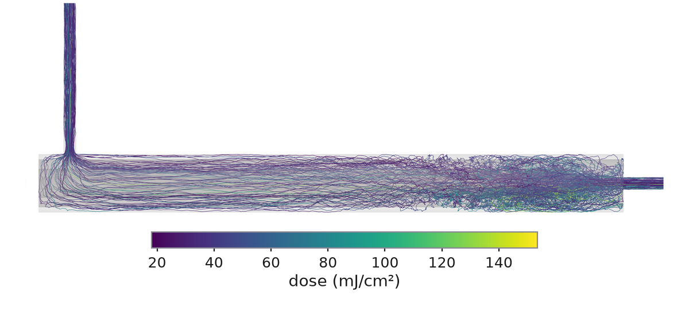
    <div class="app-sub">UV lamp with water flowing past. Particle tracks coloured by dose.</div>
  </div>
  <div class="app">
    <div class="app-head">Air: germicidal UV in rooms</div>
    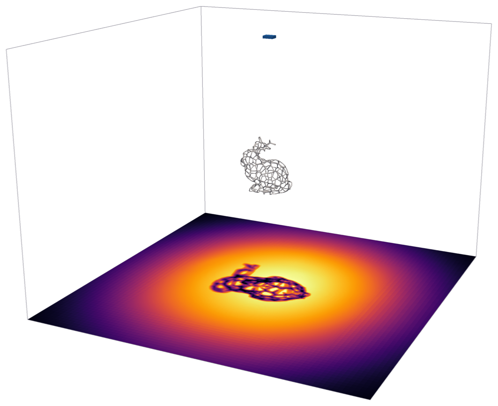
    <div class="app-sub">A far-UVC (222 nm) lamp on the ceiling of an occupied room.</div>
  </div>
</div>
```

[Both are designed against the dose distribution, $D = \int G \cdot dt$, along each path, which CFD simulations can predict before a bioassay or a field test.]{.takeaway}

::: {.notes}
- CFD in UV reactors for water has a well-established protocol.
- CFD for GUV applications is newer; in theory the same workflow applies.
- Both are designed on the dose integrated along pathogen paths, which CFD can compute.
- This talk introduces an open-source workflow for both, highlighting some of the challenges in GUV applications.
:::

## Fluent can model UV reactors but is closed source; OpenFOAM lacks the radiation and dose links

```{=html}
<div class="pipeline">
  <div class="stage">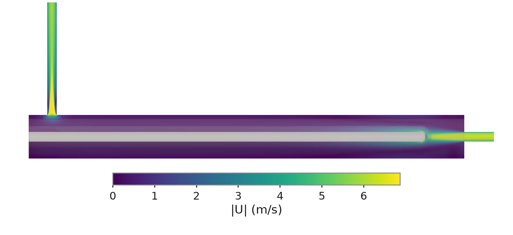
    <div class="label">Flow</div><div class="sub">U, k, ω from RANS</div></div>
  <div class="arrow">→</div>
  <div class="stage">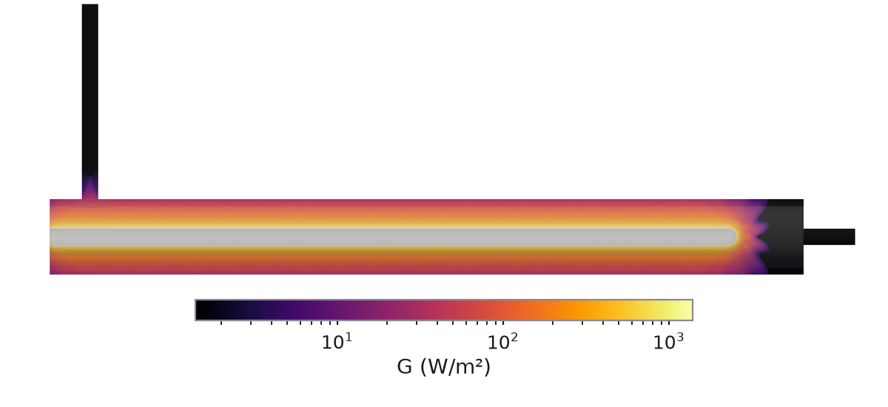
    <div class="label">Radiation</div><div class="sub">G from the RTE</div></div>
  <div class="arrow">→</div>
  <div class="stage">
    <div class="label">Particle tracks</div><div class="sub">Lagrangian, Langevin</div></div>
  <div class="arrow">→</div>
  <div class="stage">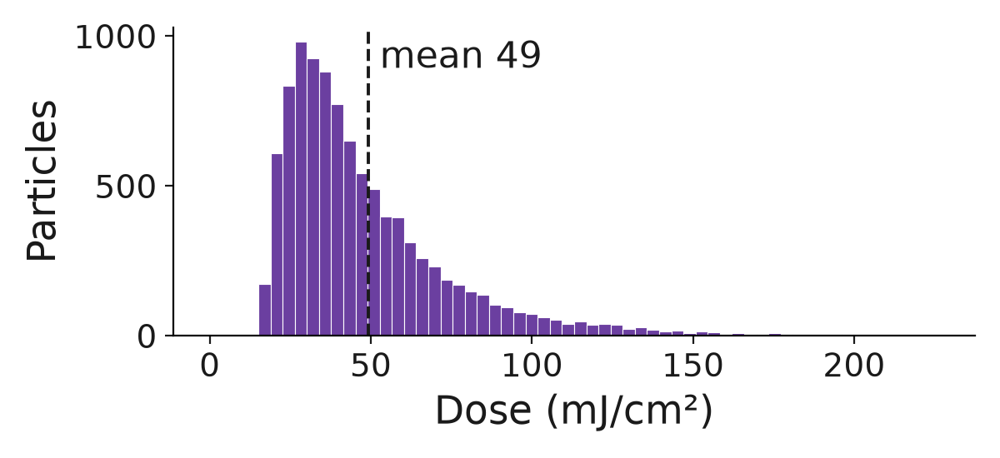
    <div class="label">Dose distribution</div><div class="sub">D = ∫G dt per particle</div></div>
  <div class="arrow">→</div>
  <div class="stage">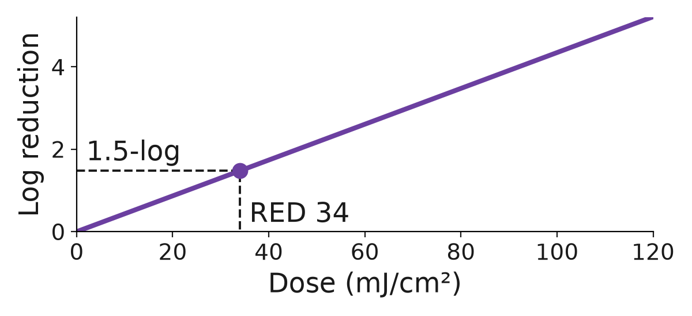
    <div class="label">Log reduction and RED</div><div class="sub">MS2-like, k = 0.1 cm²/mJ</div></div>
</div>
<div class="pipeline brackets">
  <div class="br" style="grid-column: 1">CFD</div>
  <div class="br" style="grid-column: 3">Fluence-rate field</div>
  <div class="br" style="grid-column: 5 / 8">Dose integral</div>
  <div class="br" style="grid-column: 9">Dose response</div>
</div>
<div class="pipeline fluent-row fragment" data-fragment-index="1">
  <div class="fl-tag" style="grid-column: 1"><b>Mature</b><br>closed source</div>
  <div class="fl-tag" style="grid-column: 3"><b>Capable</b><br>DO model for UV reactors</div>
  <div class="fl-tag" style="grid-column: 5 / 8"><b>Requires customization</b><br>particle tracking built in; dose accumulation is a UDF each group writes, rarely published</div>
  <div class="row-tag fl">← Fluent</div>
</div>
<div class="pipeline fluent-row of-row fragment" data-fragment-index="2">
  <div class="fl-tag of" style="grid-column: 1"><b>Mature</b><br>open source</div>
  <div class="fl-tag of missing" style="grid-column: 3"><b>Missing</b><br>DO model built for thermal radiation</div>
  <div class="fl-tag of" style="grid-column: 5 / 8"><b>Requires customization</b><br>particle tracking exists; dose accumulation must be coded</div>
  <div class="row-tag of">← OpenFOAM</div>
</div>
```

::: {.notes}
- The chain is flow, radiation (G), particle paths, dose. Flow is well served by standard CFD; the links that decide a UV answer are G and the dose integral.
- Fluent does the whole job: DO is the water-sector standard, but dose is a UDF each group writes and rarely publishes, so results are hard to inspect or reproduce across groups.
- OpenFOAM is open and mature for the flow, but has no radiation model that can represent a UV lamp, and nothing accumulates dose along Lagrangian tracks.
- This talk fills both gaps in the open.
:::

## OpenFOAM's built-in fvDOM is built for thermal radiation and cannot represent a UV lamp

```{=html}
<table class="compare">
<thead><tr>
<th style="width:16%"></th>
<th class="fv" style="width:27%">OpenFOAM 13 fvDOM</th>
<th class="fl" style="width:28%">Fluent DO</th>
<th class="tw" style="width:29%">This work</th>
</tr></thead>
<tbody>
<tr><td class="cap">Light source</td>
<td class="fv">Blackbody emission from T, coupled to the energy equation</td>
<td class="fl">Blackbody emission from T, energy coupling optional</td>
<td class="tw">Emitting boundaries, no temperature needed</td></tr>
<tr><td class="cap">Scattering</td>
<td class="fv">None (scatter coefficient ignored)</td>
<td class="fl">Isotropic, linear-anisotropic, Delta-Eddington, user-defined</td>
<td class="tw">Isotropic, Henyey–Greenstein, Schlick, Rayleigh, Mie</td></tr>
<tr><td class="cap">Pixelation</td>
<td class="fv">No</td>
<td class="fl">Yes (Mathur &amp; Murthy)</td>
<td class="tw">Yes (Mathur &amp; Murthy)</td></tr>
<tr><td class="cap">Refraction</td>
<td class="fv">No</td>
<td class="fl">Yes, Snell and Fresnel at semi-transparent walls</td>
<td class="tw">Yes, Snell and Fresnel at interfaces, multi-region</td></tr>
<tr><td class="cap">Wall reflection</td>
<td class="fv">Diffuse</td>
<td class="fl">Diffuse, specular</td>
<td class="tw">Diffuse, specular</td></tr>
<tr><td class="cap">Collimated beam</td>
<td class="fv">No</td>
<td class="fl">Yes</td>
<td class="tw">Yes</td></tr>
<tr><td class="cap">Photometric (IES) source</td>
<td class="fv">No</td>
<td class="fl">With UDF</td>
<td class="tw">Yes (LM-63)</td></tr>
<tr><td class="cap">Spectral</td>
<td class="fv">Wide bands weighted by blackbody fractions</td>
<td class="fl">User-defined bands, per-band absorption</td>
<td class="tw">User-defined bands, per-band absorption</td></tr>
</tbody>
</table>
```

::: {.notes}
- fvDOM is a thermal model: its only source is blackbody emission from the temperature field, coupled to the energy equation.
- The header says "not including scatter"; a scattering coefficient is silently ignored (only P1 uses it). No pixelation, no refraction.
- Right-hand column: everything the water sector uses in Fluent is covered, plus native IES input (a UDF boundary condition in Fluent).
- If asked: Fluent can run without the energy equation (T = 0 K removes the blackbody term); the n² radiance scaling at interfaces is in our code and tested.
:::

## OpenFOAM 13 field-based Lagrangian model doesn't provide individual particle tracks

```{=html}
<table class="compare">
<thead><tr>
<th style="width:18%"></th>
<th class="fv" style="width:27%">OF Field-Based Lagrangian</th>
<th class="fl" style="width:27%">Fluent DPM</th>
<th class="tw" style="width:28%">This work</th>
</tr></thead>
<tbody>
<tr><td class="cap">Persistent particle ID</td>
<td class="fv">No</td>
<td class="fl">Yes</td>
<td class="tw">Yes, inlet to outlet</td></tr>
<tr><td class="cap">Per-particle tracks</td>
<td class="fv">No (cloud-level function objects only)</td>
<td class="fl">Yes</td>
<td class="tw">Yes (CSV and VTK)</td></tr>
<tr><td class="cap">Dose D = &int;G dt</td>
<td class="fv">Custom C++</td>
<td class="fl">UDF written by each group</td>
<td class="tw">Built in</td></tr>
<tr><td class="cap">Seeding</td>
<td class="fv">Injection models: patch, point, disk, volume, manual</td>
<td class="fl">Injections: user-set position, velocity and diameter</td>
<td class="tw">Patch injection</td></tr>
<tr><td class="cap">Turbulent dispersion</td>
<td class="fv">Discrete random walk</td>
<td class="fl">Discrete random walk; particle cloud (mean path and spread, no individual particles)</td>
<td class="tw">Well-mixed Langevin (used here); random displacement; discrete random walk, with or without well-mixed drift</td></tr>
<tr><td class="cap">Wall interaction</td>
<td class="fv">Rebound (restitution), stick, escape</td>
<td class="fl">Reflection (restitution coefficients)</td>
<td class="tw">Reflection, escape at outlet</td></tr>
</tbody>
</table>
```

::: {.fig-below}
{style="height:130px"}
:::

::: {.notes}
- OpenFOAM 13 is moving to a field-based Lagrangian library (65 % complete in v13, 80 % in v14): particles are elements of a Lagrangian mesh and each property is a field. The OpenFOAM column is that library, the stated direction. Each row records the finite-volume cell its particle is in, so many particles share a cell, and the rows are re-sorted as particles reach patches or are removed: a row number is a position, not an ID.
- If asked: the legacy parcel library is still shipped and does keep an ID per particle (origProc, origId), with the particleTracks utility to assemble tracks; it is the approach OpenFOAM is moving away from.
- Injection and wall interaction are a tie between OpenFOAM and Fluent.
- Dispersion: both offer the discrete random walk (Gosman and Ioannides). OpenFOAM 13 has three variants: stochasticDispersionRAS and gradientDispersionRAS in the parcel library, turbulentDispersion in the field-based one. Fluent's is stochastic tracking, with an optional random eddy lifetime. Neither corrects the walk for varying turbulence, so on a wall-resolved mesh it collects particles in low-turbulence regions near the wall. Fluent's other option, particle cloud tracking, follows a Gaussian cloud about a mean path rather than individual particles, so it gives no per-particle dose.
- We have the discrete random walk too, with the well-mixed corrections (drift down the diffusivity gradient, exact eddy accounting, eddy reflection at walls) or without them, plus a random-displacement model and the well-mixed Langevin model (Thomson 1987) used for every result here (Appendix 2).
- What differs is identity and output: the field-based library keeps no persistent particle ID and writes no per-particle track or dose. Fluent writes tracks, but dose is a UDF.
- A custom C++ function object could accumulate dose (cloudAge does this for age), but there is no supported dictionary-level way and the API is changing.
- Checked against the Fluent 2025 R2 Theory Guide and the OpenFOAM 13 source.
:::

## uvmesh builds the pipe O-grids and lamp layers that a general mesher leaves you to set up by hand

```{=html}
<div class="trio">
  <div>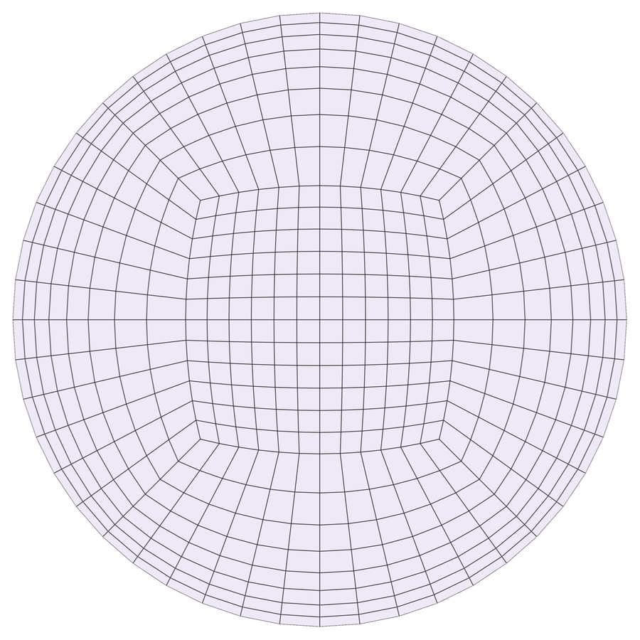
    <div class="label">Pipe O-grid</div>
    <div class="sub">The inlet pipe's open end</div></div>
  <div>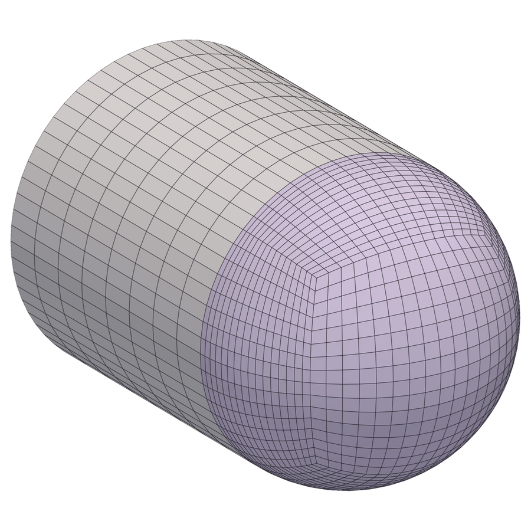
    <div class="label">Lamp sleeve and tip</div>
    <div class="sub">A cubed-sphere cap joins the sleeve's O-grid</div></div>
  <div>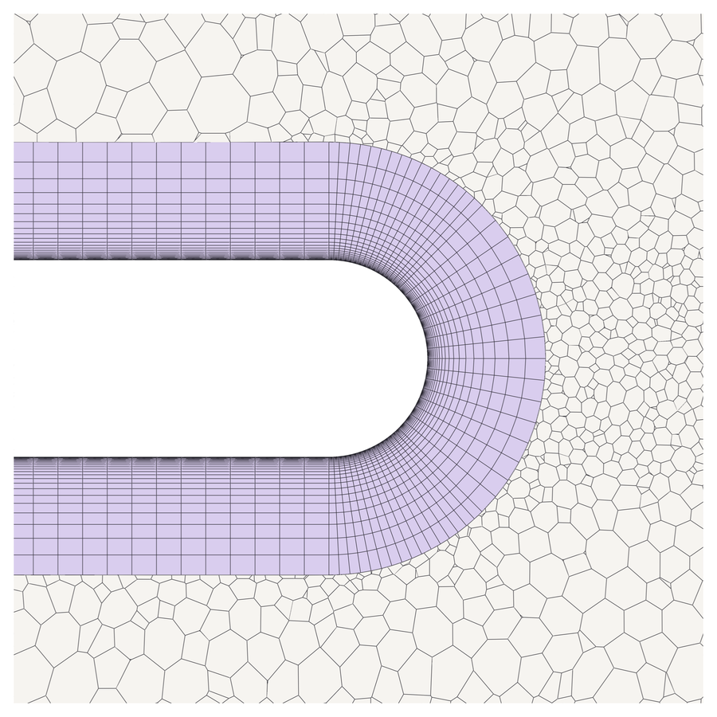
    <div class="label">Lamp layer and polyhedral bulk</div>
    <div class="sub">Slice at the tip: 26 layers from a 20 µm first cell</div></div>
</div>
```

[Each lamp, pipe and wall layer is one line of a Python script; uvmesh fills the rest of the STEP body with polyhedra and couples the pieces non-conformally.]{.takeaway}

[The Sozzi & Taghipour reactor from its STEP file: 1.23 M cells, maximum non-orthogonality 53°, built in about 2 minutes.]{.src}

::: {.notes}
- Any general mesher can produce these meshes; the work is in the set-up: an O-grid for every pipe, a graded sleeve layer fine enough for y+ near 1, and a cubed-sphere cap so no cell collapses at the lamp's pole.
- uvmesh builds them from a short Python description (Lamp, Pipe, wall layer, STEP body). Structured pieces are hexahedra; gmsh fills the rest with tetrahedra, converted to polyhedra, and OpenFOAM 13's non-conformal couplings join them.
- Numbers: 64 cells around the sleeve, 26 graded layers out to 22 mm, 12 cells per quadrant on the pipes.
- Details in Appendix 3.
:::

## Our DOM library has the features UV reactors use and runs three ways

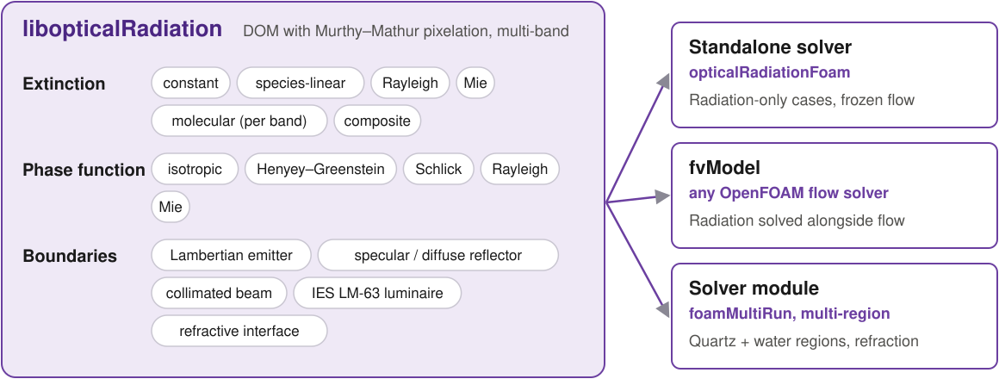{.fig-fill}

::: {.notes}
- One library, three ways to run it.
- Standalone, radiation on a frozen flow: the usual UV reactor workflow.
- As an fvModel inside any OpenFOAM flow solver, with no change to that solver.
- As a solver module in multi-region cases: quartz sleeve and water coupled with refraction at the interface.
:::

## Every feature is checked against an analytical answer on every commit

::: {.columns}
::: {.column width="46%"}
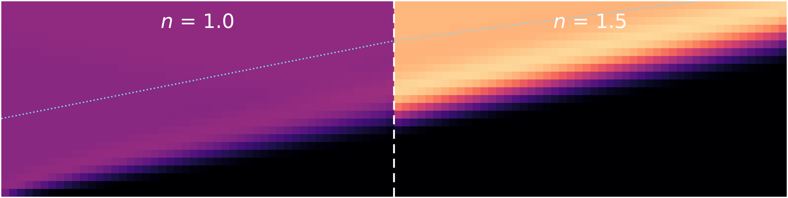{.fig-fill}

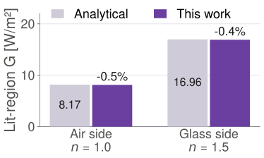{.fig-fill}
:::
::: {.column width="4%"}
:::
::: {.column width="50%"}
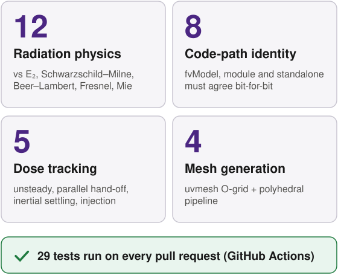{.fig-fill}
:::
:::

::: {.notes}
- Example: a collimated beam from n = 1.0 into n = 1.5. The analytical answer includes Fresnel reflection and the n² étendue factor, so G on the glass side is about 2.08 times the air side; the code reproduces it to about 1 %.
- The 29 regression tests run on every pull request, so a change that breaks physics cannot be merged quietly.
:::

## A purpose-built tracker accumulates D = ∫G·dt with no extra work

::: {.columns}
::: {.column width="62%"}
::: {.dict}
```{.cpp code-line-numbers="7-12"}
radiationDose
{
    type          radiationDose;
    libs          ("libradiationDose.so");
    U             U;
    fluenceRate   G;
    seeding
    {
        type        patchInjection;
        patches     (inlet);
        nParticles  10000;
    }
    dispersion    { type langevin; omega omega; }
    termination   { escapePatches (outlet); wallReflection true; }
    output        { kInact (0.1); }
}
```
:::
[Trimmed from the Sozzi case's system/postProcess.dict (the tutorial's, with the Langevin model reading the SST ω) and run with foamPostProcess.]{.src .tight}
:::
::: {.column width="38%"}
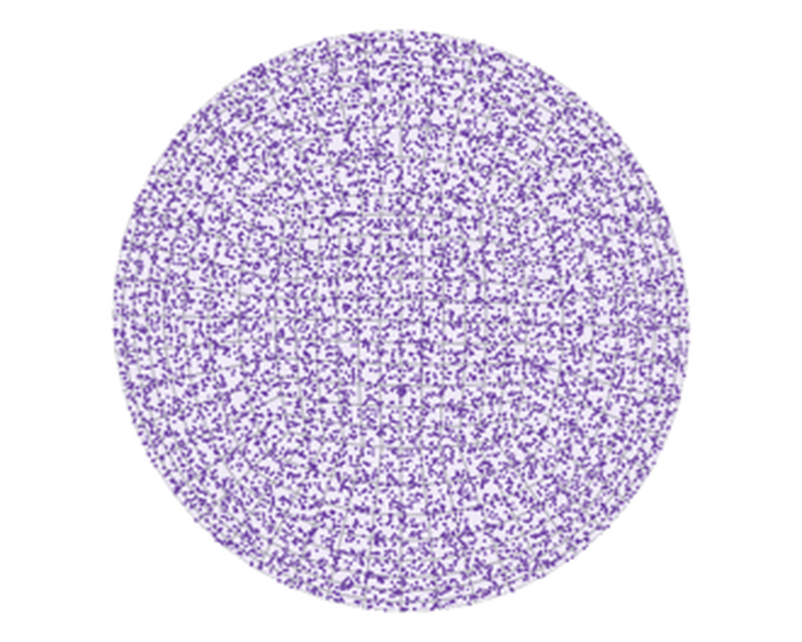{.fig-fill}

[10,000 requested; 9,987 seeded on the inlet's 528 faces, in proportion to their area.]{.src .tight}

[It reads G as a field, so any radiation solver can feed it.]{.takeaway}
:::
:::

::: {.notes}
- This is the whole dose calculation: name the velocity and fluence-rate fields, say where to inject, run it as a post-process. No UDF, no equation to write.
- Outputs: a per-particle dose CSV, a summary with log reduction at any inactivation constants you list, and VTK tracks for ParaView.
- The tracker only reads G as a field and does not care which solver wrote it; the end of the talk uses that.
- If asked about drift: tracking uses OpenFOAM's barycentric-tet particle class, so it is drift-free and hands particles across processors (Appendix 2).
:::

## Our DOM and dose tracker match Fluent on the Sozzi & Taghipour reactor

::: {.columns}
::: {.column width="50%"}
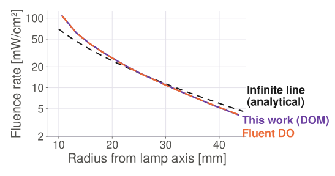{.fig-fill .figctr style="height:300px;width:auto"}
:::
::: {.column width="50%"}
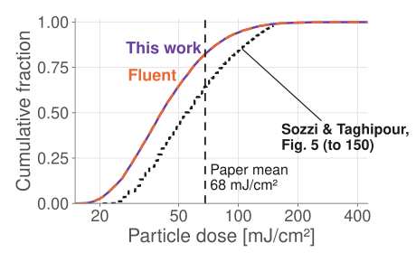{.fig-fill .figctr style="height:300px;width:auto"}
:::
:::

```{=html}
<table class="stats">
<thead><tr><th></th><th class="ctx">Measured, prototype reactor</th><th>Sozzi &amp; Taghipour (2006)</th>
<th class="tw">This work, line source</th><th class="tw">This work, DOM</th>
<th class="fl">Fluent DO</th></tr></thead>
<tbody>
<tr><th>Mean dose [mJ/cm²]</th><td class="ctx">&mdash;</td><td>68</td><td>44.3</td><td>49.5</td><td>49.4</td></tr>
<tr><th>Log reduction, k = 0.1 cm²/mJ</th><td class="ctx">1.51</td><td>1.87</td><td>1.47</td><td>1.49</td><td>1.49</td></tr>
</tbody>
</table>
```

[In a steady flow the mean dose cannot exceed ∫G dV / Q. Ours is within about 1 % of it (49.5 against 49.0 mJ/cm²); the paper's 68 is 39 % above the 49 its own lamp model allows.]{.takeaway}

::: {.notes}
- Simulations on the Sozzi & Taghipour reactor, using the OpenFOAM flow and particle tracking with the radiation model swapped out.
- Radiation modelled three ways: line source, our OpenFOAM DO model, and Fluent DO.
- The models agree well with each other.
- Fluent DO was solved on this same mesh at the matching 6 × 6 per octant, exported to CGNS, and its G copied cell for cell into the OpenFOAM case (of-mesh-converter `transfer`, no interpolation). Same flow and the same particles as our DO, so only G changes: mean dose 49.4 against 49.5, log reduction 1.49 for both; the reactor-averaged G differs by 0.2 % (134.0 against 134.2 W/m²).
- Our predicted mean dose is lower than Sozzi's, but close to the maximum mean dose a steady flow allows (the ∫G dV / Q ceiling), which Sozzi's 68 exceeds.
- Over-sampling of near-lamp regions is common for wall-resolved turbulence with a discrete random walk: particles aggregate where k is low. We avoid it with the Langevin model, which keeps those cells well mixed.
- Our log reductions (1.47 and 1.49) are also closer to the biodosimetry Sozzi measured on a similar prototype (1.51) than their model's 1.87.
- DO here: 288 directions on a uniform grid (nPhi = nTheta = 12, every bin 15° square); the matching Fluent setting is 6 × 6 θ × φ divisions per octant. At 72 directions (30° bins; Fluent 3 × 3) both codes come out lower by the same amount: ours 49.2 and 1.47, Fluent 49.1 and 1.47. The gap grows with k (about 2 % in log reduction at k = 0.5; slide 15), so we report 288.
- Prototype differs from the simulated reactor (Table 1 of the paper): 8.6 cm body (vs 8.9), 101 cm long (vs 88.9), 88 cm lamp arc (vs 80), 2.26 cm lamp (vs 2), 2.24 cm inlet/outlet (vs 1.91), plus a lamp holder and an outlet reduction ring. Same 35 W output.
- Mean dose integral (∫G dV / Q) for the prototype, using their MPSS lamp model at 70 % UVT and 25 GPM: about 47 mJ/cm², slightly below the simulated reactor's 49 (the larger sleeve displaces water that the longer arc adds back; holder and ring not included).
:::

## Open source makes the workflow inspectable, reproducible and scalable

::: {.columns}
::: {.column width="47%"}
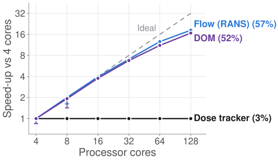{.fig-fill}

[Chiu et al. (1999) channel in 3-D, about 7 million cells, 256 ray directions (16 × 8 bins). One whole node per run on Nibi (Digital Research Alliance of Canada): 2\ ×\ Intel Xeon 6972P, 192 cores at 2.4 GHz, 748 GB; two or three runs per point.]{.src .tight}
:::
::: {.column width="4%"}
:::
::: {.column width="49%"}
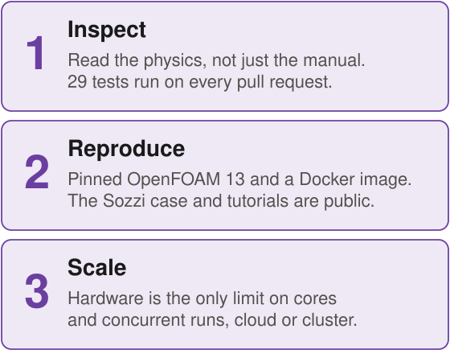{.fig-fill}
:::
:::

::: {.notes}
- Inspect: anyone can read how G and dose are computed, and the 29 tests run on every pull request.
- Reproduce: OpenFOAM version pinned, Docker image included, the Sozzi case is a public tutorial.
- Scale: strong scaling on whole CPU nodes of Nibi, a Digital Research Alliance of Canada cluster (2 × Intel Xeon 6972P, 96 cores each at 2.4 GHz, 748 GB), so no other job shares the memory bandwidth. Flow and DOM track the ideal line to 16 cores, are at 88 % and 84 % at 32 cores, and reach 57 % and 52 % of ideal at 128 cores (18x and 17x over 4 cores). Repeat runs agree to within 1 to 4 % from 16 cores up. Past 96 cores the job spans both sockets of the node, which may be part of the drop.
- On shared nodes the same runs were up to 2x slower and much noisier, so these numbers come from exclusive nodes.
- The dose tracker is serial and takes five to six minutes for 10,000 particles on the 1.2-million-cell mesh, so it is not the limit.
- The only limit on cores or concurrent runs is the hardware.
:::

## On paper, the library already covers GUV: 222 nm absorbers, measured luminaires and occupant exposure

::: {.columns}
::: {.column width="25%"}
[222 nm absorbers]{.panel-head .ctr}

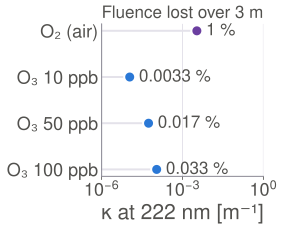{.fig-fill .figctr style="max-height:210px"}

[Ushio B1 luminaire]{.panel-head .ctr}

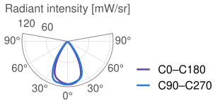{.fig-fill .figctr style="max-height:185px"}
:::
::: {.column width="75%"}
[Four fixtures, four occupants]{.panel-head .ctr}

```{=html}
<div class="dummy-pair">
  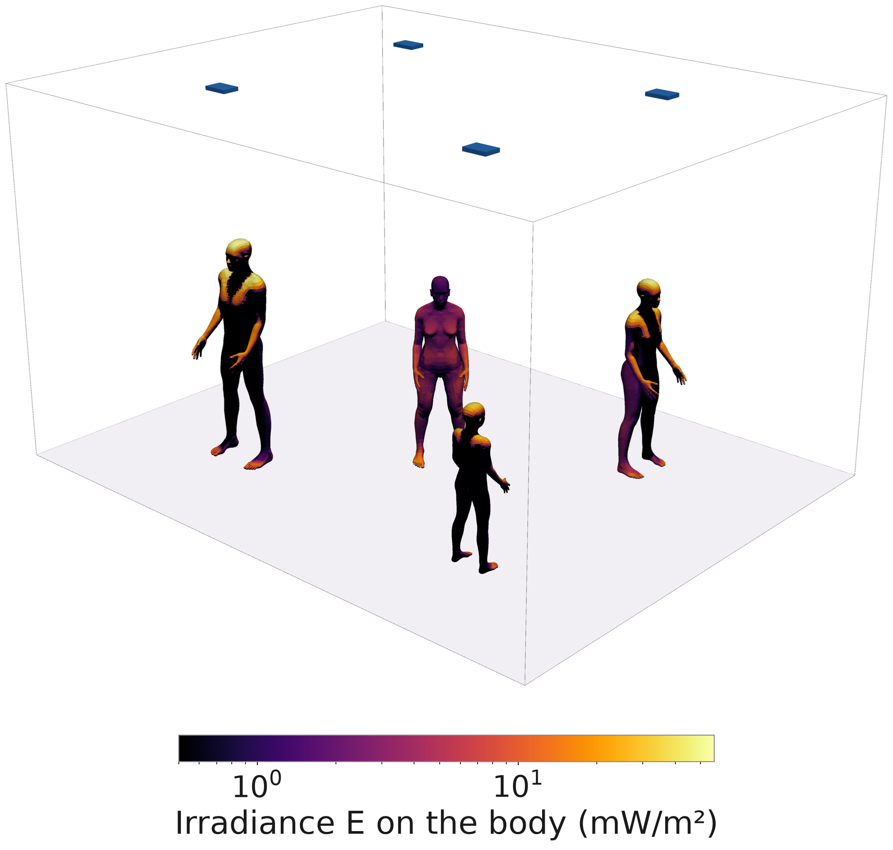
  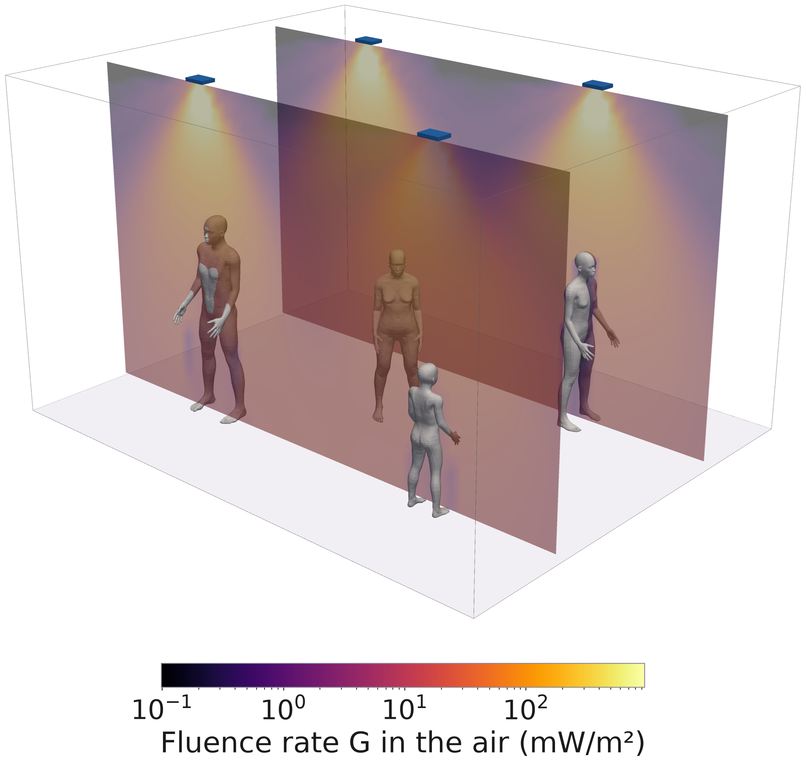
</div>
```
:::
:::

::: {.notes}
- For air, the needs change: O2 and O3 absorption at 222 nm come from user-supplied cross-sections per band. Ozone loss over a room is small (about 1 % over 3 m, mostly O2), and the same machinery gives the absorbed photon rate that drives ozone chemistry.
- The luminaire is the measured OSLUV IES file for the Ushio B1, read directly by the iesEmitter boundary condition.
- Room: 5 × 4 × 3 m, four fixtures, four parametric occupants (Anny, not scans): adult man, adult woman and child under fixtures, an older woman at the centre.
- Left image is irradiance on each body, which is what an exposure limit is written for; right is G in the air on two planes through the fixtures, on a 10 cm Cartesian grid with no mesh.
- Eye irradiance under a fixture: about 3 h to the 23 mJ/cm² ACGIH limit for the adult, 6.7 h for the child, about 30 h at the centre. Walls are black and occupants stationary, so dose is irradiance times time.
- But a room is the opposite of the reactor we validated in: water absorbs and the lamp is a long tube, while air is almost transparent and a far-UVC fixture is a window a few centimetres across. That is where DO struggles.
:::

## In a far-UVC room, DO ray effects erase the bunny's shadow, even with 288 directions

::: {.columns}
::: {.column width="41%"}
```{=html}
<div class="renders">
  
  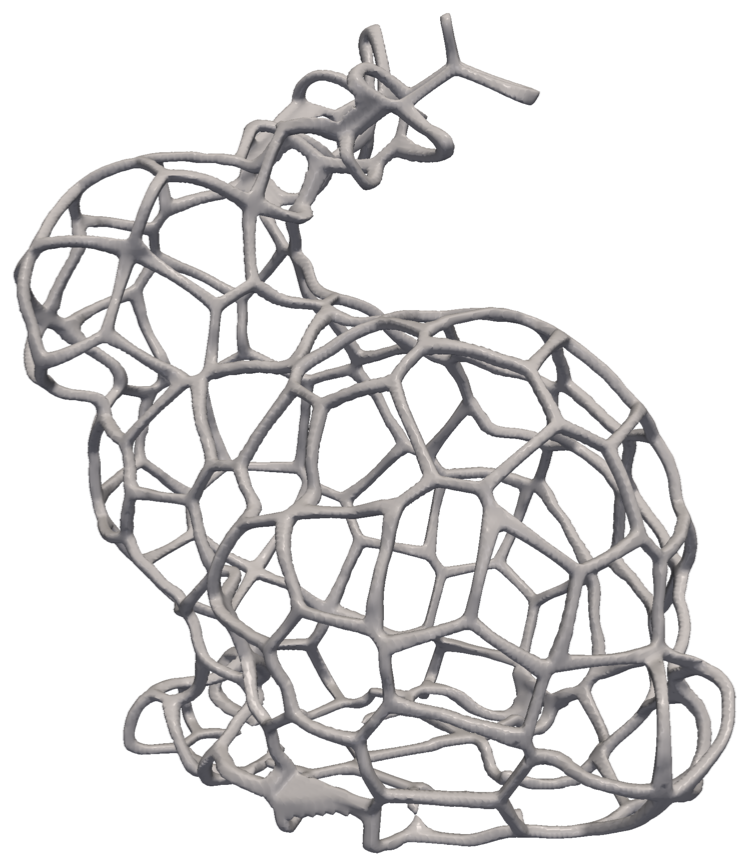
</div>
```
[4 × 4 × 3 m, 222 nm, black walls, Ushio B1 (IES); bunny 0.6 m tall at 1.2 m.]{.src .tight}

::: {.keypoints}
- One beam per DO direction; clean air never blurs it
- 72 directions: 12 spots 0.8 m out, up to 23× too bright
- 288 directions: a ring and 24 spots, up to 6.4×
- The shadow is lost in both
:::

[**Exact:** each floor point ray-traced to 17,920 points on the lamp window. Direct light only: it cannot follow a reflection, so it works only for this black-walled test room.]{.src .tight .note}
:::
::: {.column width="59%"}
[Irradiance over the whole 4 × 4 m floor]{.panel-head .ctr}

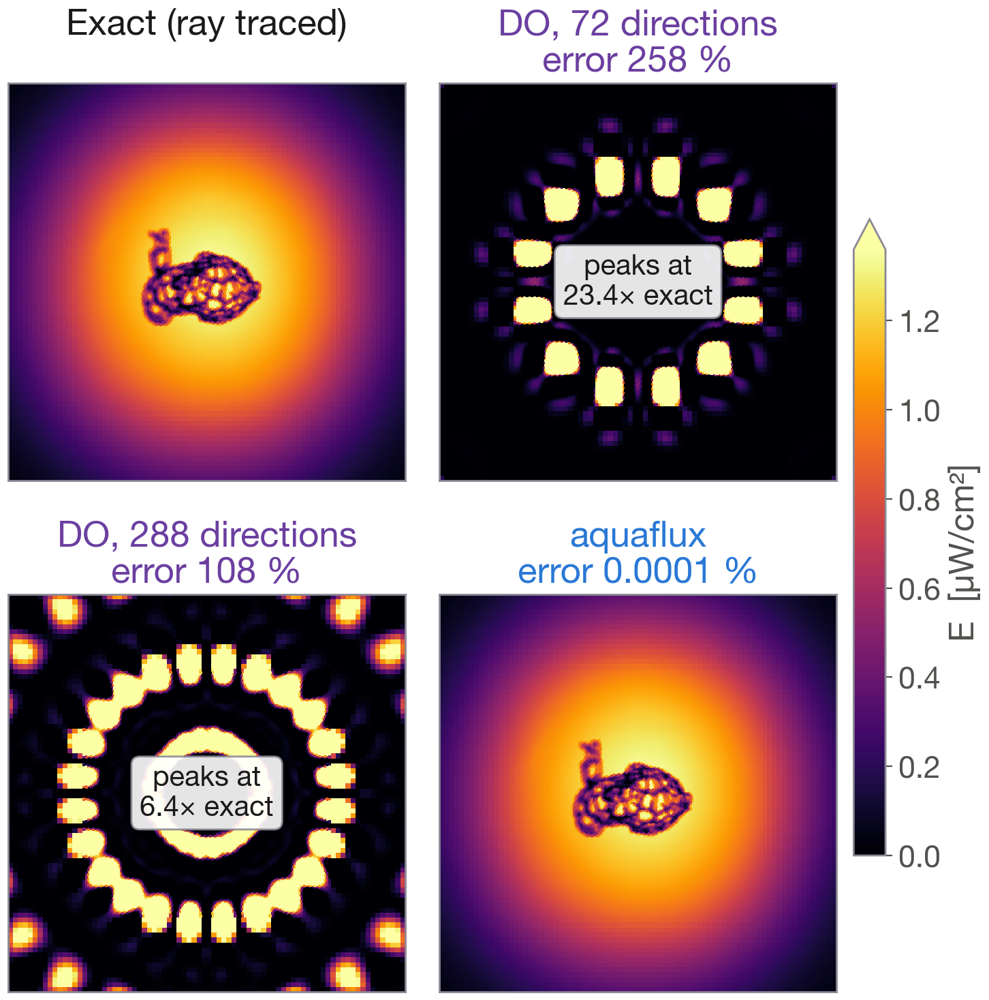{.maps}

[**Error:** area-weighted RMS difference from the exact field, as a share of its peak; colour clipped at that peak. 2.5 M cells; DO on uniform angular grids, 3 × 3 pixels at 72 (1 × 1 identical), 1 × 1 at 288, converged to 10⁻⁵.]{.src .tight}
:::
:::

::: {.notes}
- DO is right for reactors because absorption and long lamps blur the beams. In a room the fixture is a 6 × 4.5 cm window, so each discrete direction becomes a searchlight.
- Exact reference: every floor point ray-traced to 17,920 points on the lamp window. Exact only because the walls are black; it cannot follow a reflection.
- 72 directions (bins 30° square): the most nearly vertical directions are 15° off the vertical in 12 azimuths, so the light lands in 12 spots about 0.8 m out, each up to 23× the exact peak; the central 2 × 2 m gets 48 % of the lamp's power where the exact answer has 34 %.
- 288 directions (bins 15°): a bright ring at about 0.4 m, 24 spots at about 1.2 m and spots in the corners; 24 % in the central 2 × 2 m. The shadow is gone in both because no beam passes through the bunny.
- The grids are uniform (nPhi = nTheta; Fluent's 3 × 3 and 6 × 6 per octant). An earlier 8 × 4 grid had 45° polar bins, so its nearest-vertical beams sat 22.5° off and lit almost nothing under the lamp (0.1 % of the power in the central 2 × 2 m).
- If asked about energy: our DO conserves lamp power exactly; the error is in where the light goes. The second-order scheme also undershoots beside each beam, with negative irradiance totalling −19 % of lamp power at 72 directions and −12 % at 288 (hidden by the colour scale starting at zero).
- If asked about pixelation: at 72 directions 1 × 1 gives the same floor error as 3 × 3 to four figures, and runs 5 % faster. At 288 only 1 × 1 was run (3 × 3 swaps on this machine); the earlier 64- and 256-direction runs also agreed to four figures. Pixels fix faces that cut across a bin; this mesh is mostly axis-aligned hexes.
- Ray effects are a known property of every discrete-ordinates model, Fluent's included.
:::

## aquaflux sums every lamp facet exactly, so it has no ray effects and runs faster than DO

::: {.columns}
::: {.column width="36%"}
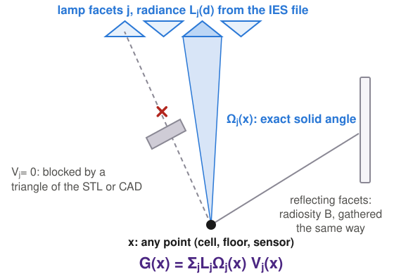{.gather}

::: {.method}
- No angular grid: each lamp triangle's exact solid angle times its measured IES radiance
- Shadows from the STL or CAD triangles directly, with no volume mesh
- Reflecting walls through diffuse radiosity, gathered the same way
:::
:::
::: {.column width="64%"}
[Fluence rate on the vertical plane through the lamp and the bunny]{.panel-head .ctr}

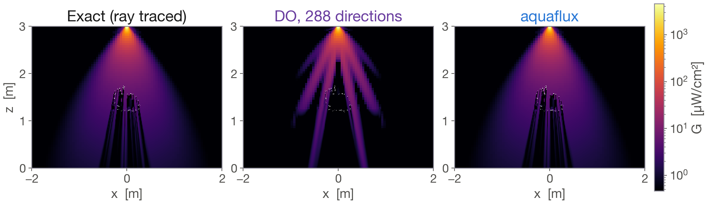{.fig-fill .figctr}

```{=html}
<div class="room-foot">
<div>
<table class="stats room">
<thead><tr><th></th><th>Floor and 2.5 M cells</th><th>Floor error</th></tr></thead>
<tbody>
<tr><th class="dom">DO, 72 directions</th><td>47 min</td><td>258 %</td></tr>
<tr><th class="dom">DO, 288 directions</th><td>3.0 h*</td><td>108 %</td></tr>
<tr><th class="aq">aquaflux</th><td>19 min</td><td>0.0001 %</td></tr>
</tbody>
</table>
<span class="src tight">One workstation: DO on 8 MPI ranks, 3 × 3 pixels; aquaflux on 11 cores. *1 × 1 pixels (3 × 3 swaps at this size).</span>
</div>
<div class="status"><b>Early, under active development.</b> Not yet: scattering, refraction,
specular reflection.</div>
</div>
```
:::
:::

::: {.notes}
- aquaflux turns the problem around: start at the point where G is wanted and ask each lamp triangle how much of its light arrives: exact solid angle × IES radiance × a visibility test. No discrete directions, so nothing to make ray effects from.
- Geometry is used as it is (STL, or STEP through OpenCASCADE), with no volume mesh. Reflecting walls use a radiosity solve between surface facets, then are gathered the same way.
- Written in JAX, so it is differentiable with respect to the optics (not the lamp position through the radiosity solve).
- Cost on one workstation: floor plus all 2.5 million cells in 19 min. DO: 47 min at 72 directions (3 × 3 pixels), 3.0 h at 288 (1 × 1; 3 × 3 swaps at this size), and wrong in both. With reflecting walls (0.5): aquaflux 70 min, DO at 72 directions 4.1 h (65 sweeps against 37 black).
- If asked about the exact field: it ray-traces points one at a time and cannot follow reflections; aquaflux can.
- aquaflux is early: no scattering, refraction or specular reflection yet (all in development). For a water reactor with a quartz sleeve, use DO today.
:::

## Only the radiation solver changes: the OpenFOAM flow and dose tracker are used as they are

```{=html}
<div class="pipeline swap-row">
  <div class="stage">
    <div class="label">Flow</div><div class="sub">OpenFOAM RANS</div></div>
  <div class="arrow">→</div>
  <div class="stage swap">
    <div class="opt dom"><b>DO model</b><br>water reactors</div>
    <div class="opt aq"><b>aquaflux</b><br>rooms, clear air</div>
    <div class="label">Radiation</div><div class="sub">writes G as an OpenFOAM field</div></div>
  <div class="arrow">→</div>
  <div class="stage">
    <div class="label">Particle tracks</div><div class="sub">radiationDose</div></div>
  <div class="arrow">→</div>
  <div class="stage">
    <div class="label">Dose distribution</div><div class="sub">D = ∫G dt per particle</div></div>
  <div class="arrow">→</div>
  <div class="stage">
    <div class="label">Log reduction and RED</div><div class="sub">as before</div></div>
</div>
<div class="pipeline brackets">
  <div class="br same" style="grid-column: 1">unchanged</div>
  <div class="br" style="grid-column: 3">swapped</div>
  <div class="br same" style="grid-column: 5 / 10">unchanged</div>
</div>
```

::: {.columns}
::: {.column width="45%"}
[Sozzi reactor: same flow and particles, only G swapped]{.panel-head}

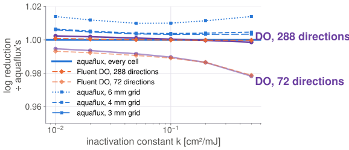{.swapchart}
:::
::: {.column width="55%"}
[G at the lamp tip; time to G (run alone) and LR at k = 0.1]{.panel-head}

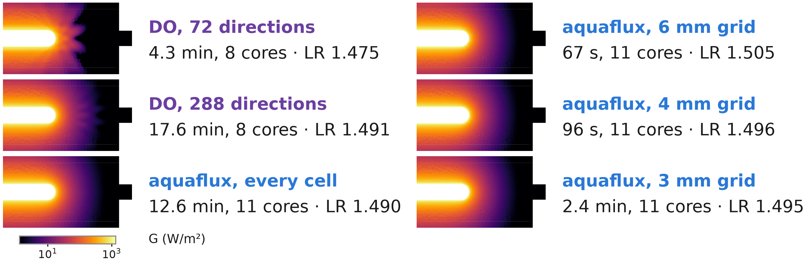{.tipcompare}
:::
:::

::: {.notes}
- Nothing about the flow or dose changes: aquaflux writes G on the same OpenFOAM mesh as a field, and the same tracker reads it, as it read the DO and analytical fields on the Sozzi slide.
- Chart: same mesh, flow and tracker, with every run following the same 9,987 particle paths; only G differs.
- Log reduction relative to aquaflux: DO at 288 directions within 0.23 % at every k, which is why DO is the right tool for water. DO at 72 is 1.0 % short at k = 0.1 and 2.2 % short at k = 0.5: log reduction is set by the few particles that dodge the light, and that is where ray effects put what error remains in water.
- Fluent DO on the same mesh (orange, dashed), its G copied cell for cell into the same case: at 288 directions (6 × 6 per octant) within 0.08 % of aquaflux at every k; at 72 (3 × 3) 1.1 % short at k = 0.1 and 2.1 % at k = 0.5, the same shortfall as ours. So the 72-direction error is the angular grid, not our implementation.
- Reactor-mean G: 133.8 W/m² (aquaflux), 134.2 (DO 288), 133.3 (DO 72), 134.0 (Fluent 288), 133.1 (Fluent 72).
- DO grids are uniform: nPhi = nTheta, every bin 30° (72 directions) or 15° (288) square; Fluent's equivalents are 3 × 3 and 6 × 6 θ × φ divisions per octant. An earlier 8 × 4 grid (64 directions, polar bins twice the azimuthal) fell 12 % short at k = 0.5; most of that was the grid's shape, not its count.
- Configuration: uvmesh mesh, k-ω SST, Langevin, black walls; DO with linearUpwind rays; aquaflux on the mesh's own lamp patches coarsened to 16,878 facets; zero-gradient G on the patches (DO 288 with its own patch values agrees to 0.01 %).
- Right column: where the 72-direction shortfall comes from. G on the plane through the lamp axis around the hemispherical tip, one log scale. Past the tip DO 72 puts the light in streaks along its directions with dark wedges between; at 288 they are narrower and fainter; aquaflux sums every lamp facet and has none.
- Times, each solve alone on the same laptop: DO 72 4.3 min, DO 288 17.6 min, aquaflux at every cell 12.6 min, so aquaflux costs less than the DO that matches it.
- Right-hand column: aquaflux gathered only at the nodes of a Cartesian background grid and interpolated to the CFD cells, the way the room case computes G. At each cell beside the sleeve the interpolation uses the sleeve's own value, G = 2M (twice the lamp's exitance: the outgoing hemisphere at zero path length), so it is fitted between known values on both sides. 4 mm: 90,788 nodes, 96 s in all, log reduction within 0.65 % of the every-cell field at every k and mean dose 0.9 % high; 3 mm is no better; 6 mm is within 1.4 %. Those runs follow the same 9,987 particles, so the comparison is paired.
- Grid times are the whole job, like aquaflux's 12.6 min: mesh read (25 s) and lamp coarsening (20 s) are about half of the 4 mm time.
- Timing: Apple M3 Pro, 11 cores, 18 GB, 2 Oct 2026, one run at a time. DO = opticalRadiationFoam clock time on 8 MPI ranks in Docker, mesh read to field written, decomposition excluded; aquaflux = mesh read, lamp coarsening and gather, natively on 11 cores (data/sozzi_tip_timing.json).
:::

## Use DO for water reactors and aquaflux for rooms; the flow and dose workflow is shared and open

::: {.columns}
::: {.column width="30%"}
{width="300"}
:::
::: {.column width="70%"}
::: {.closing}
- **Water reactors:** the open-source DO library and dose tracker give OpenFOAM
  the lamp, optics and dose features UV reactor models need
- **Rooms:** DO ray effects remain at 288 directions and erase the shadows that
  matter for far-UVC
- **aquaflux** sums each lamp facet exactly: no ray effects, faster than DO, and
  shadows straight from CAD or STL
- **One workflow:** only the radiation solver changes; the flow and dose tracker
  are shared
- aquaflux is an alpha release: scattering, refraction and specular reflection
  are in development

**github.com/DeGrootResearchGroup**
:::
:::
:::

::: {.notes}
- Two tools, one workflow: DO for water reactors, aquaflux for rooms, and the same OpenFOAM flow and dose tracker behind both.
- Code, tests and tutorials are all public; the QR code points to the group's GitHub page (DO library, aquaflux, this deck).
- If you already have a Fluent solution, the dose tracker can run on its fields.
- Licensing: GPL obligations apply when you distribute the software; internal use and modification carry no disclosure requirement.
:::

## Appendix 1: aquaflux model {.divider}

[Describes aquaflux `main` at commit `0193c8b4` (merged 29 September 2026). Later commits may differ.]{.divider-sub}

## aquaflux model: overview

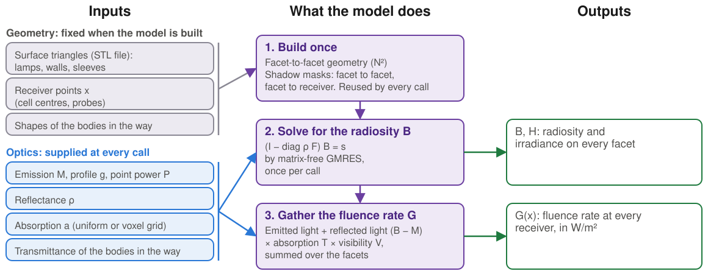{.aqfig .ov .nostretch}

::: {.aqeq .small .wrap .aqwide}
[**Build once, sweep the optics.** Everything in the blue boxes can change between calls without rebuilding. Moving a lamp or a body changes the grey boxes and needs a new model.]{.src}

[**Output and use.** $G$ is an array in the order of the receiver points, in W/m². aquaflux only outputs $G$: in the OpenFOAM workflow of the talk it is computed at the cell centres and handed to OpenFOAM, whose dose tracker integrates it along each particle path, $D=\int G\,\mathrm{d}t$. Derivatives with respect to the optics come from JAX.]{.src}

[**Scope.** One wavelength, an absorbing medium without scattering, and diffuse reflection only (see limitations). The next slides cover the gather (step 3), the radiosity solve (step 2), then the occlusion and absorption options that both steps use.]{.src}
:::

::: {.notes}
This is the map for the appendix. In the code the three steps are
build_radiation_model(receivers, surfaces, occluders), then radiosity() for B,
surface_irradiance() for H on the facets, and fluence_rate() for G at the receivers.
The build is the expensive step: the facet-to-facet transfer costs N squared, and the
shadow masks between facets and receivers cost facets times receivers. It depends only on
geometry, so a sweep over lamp power, wall reflectance or the medium's absorbance pays it
once. The surface set is passed again at each call to supply the optics; the model
records a fingerprint of the geometry and refuses a set that differs, so moving a lamp
needs a new model. The number of bounces is not a parameter, because the interreflection
is a linear system whose solution is the infinite bounce sum. The model takes receiver
positions rather than a mesh and returns a bare array in their order; it does not itself
inject the result into a transport equation. The dose tracker belongs to the OpenFOAM
workflow of the talk, not to aquaflux, which only outputs G.
:::

## aquaflux model: gather (direct light at a point)

::: {.aqrow}
::: {.aqleft}
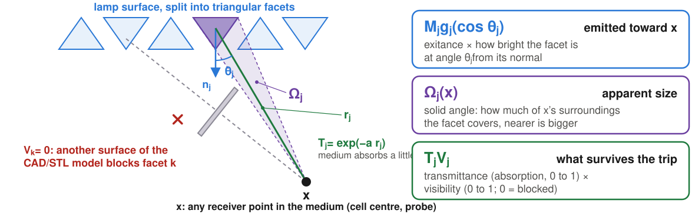{.aqfig .sm .nostretch}
:::
::: {.aqright}
**Where $g$ comes from**

Radiance of a facet:
$$L(\theta) = M\,g(\cos\theta)$$

It must emit exactly $M$ (axisymmetric):
$$2\pi\!\int_0^1 g(c)\,c\,\mathrm{d}c = 1$$

IES file ($I$ intensity, $A$ area, $\Phi = MA$; $I$ is tabulated in two angles):
$$I = L\,A\cos\theta \;\Rightarrow\; g = \frac{I(\theta)}{\Phi\cos\theta}$$

Lambertian: $g = 1/\pi$
:::
:::

::: {.aqeq}
$$G(\mathbf{x}) = \sum_{j\,\in\,\text{emitting facets}} {\color{#2a78d6}M_j\,g_j(\cos\theta_j)}\;{\color{#6b3fa0}\Omega_j(\mathbf{x})}\;{\color{#1f7a3f}T_j(\mathbf{x})\,V_j(\mathbf{x})} \;+\; \sum_{k\,\in\,\text{point sources}} \frac{P_k}{4\pi r_k^2}\,T_k V_k$$
:::

::: {.aqeq .small .compact}
::: {.columns}
::: {.column width="50%"}
| Symbol | Name | SI units |
|--|--------------------|-------|
| $G$ | fluence rate at $\mathbf{x}$ | W/m² |
| $M_j$ | exitance (power emitted per facet area) | W/m² |
| $g_j$ | radiance per unit exitance | sr⁻¹ |
| $\theta_j$ | angle: facet normal to centroid-to-$\mathbf{x}$ ray | rad |
| $\Omega_j$ | solid angle of facet seen from $\mathbf{x}$ | sr |
:::
::: {.column width="50%"}
| Symbol | Name | SI units |
|--|--------------------|-------|
| $T_j$ | transmittance along centroid-to-$\mathbf{x}$ | - |
| $V_j$ | visibility, 0 (blocked) to 1 | - |
| $a$ | absorption coefficient | m⁻¹ |
| $P_k$ | power of point source $k$ | W |
| $r_j, r_k$ | distance from centroid/source to $\mathbf{x}$ | m |
:::
:::
:::

::: {.notes}
Appendix for the aquaflux slide. Units: radiance L = M g is W/(m² sr) and M is W/m², so g has units of 1/sr; M g Ω is then W/m². Lambertian g = 1/π per sr means cosine-weighted integration over the hemisphere gives 1. Read the picture from the receiver point x:
look back at one lamp facet. Three questions: how much light does it send
toward x (exitance M times the profile g at the angle theta), how large does it
look from x (the solid angle Omega), and how much of that light survives the
trip (absorption in the air, T, and whether another surface blocks it, V).
Repeat for every facet and add. Because we sum over the lamp's own facets, there
is no angular grid, so no ray effects. The fluence rate is the radiance
integrated over the full sphere, G = ∫L dω, so it needs no surface orientation,
unlike irradiance. The solver has two steps: build_radiation_model() freezes
everything the scene's shape decides (solid angles, form factors, shadows), and
fluence_rate() then solves for the field given the optics (absorption,
reflectance, exitance). Radiance, transmittance and visibility are evaluated once
per facet at its centroid; refine_for_receivers() caps the edge-to-distance
ratio at 0.25 by default so this one-point approximation stays accurate.
Point sources use the inverse-square law.
:::

## aquaflux model: emission profile and solid angle

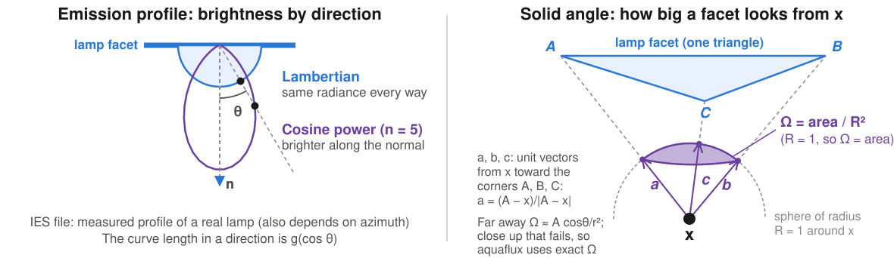{.aqfig .lg .nostretch}

::: {.aqeq .small .mid}
::: {.columns}
::: {.column width="48%"}
| Profile | $g(c)$, $c=\cos\theta$ |
|---|---|
| Lambertian | $1/\pi$ |
| Cosine power ($n\ge1$) | $(n+1)\,c^{\,n-1}/2\pi$ |
| Isotropic (point sources) | undefined; $f=1/4\pi$ |
| IES file | tabulated $I(\gamma,h)$ |
:::
::: {.column width="52%"}
$$\Omega = 2\left|\operatorname{atan2}\!\big(\mathbf{a}\!\cdot\!(\mathbf{b}\times\mathbf{c}),\; 1+\mathbf{a}\!\cdot\!\mathbf{b}+\mathbf{a}\!\cdot\!\mathbf{c}+\mathbf{b}\!\cdot\!\mathbf{c}\big)\right|$$

[**Definition:** $\Omega = (\text{area on a sphere of radius } R \text{ about } \mathbf{x}) / R^2$. With $R=1$, $\Omega$ is the patch area, in sr.]{.src}

[**Origin:** the patch is a spherical triangle; by Girard's theorem its area is the amount by which its three interior angles add up to more than $180^\circ$. Spherical trigonometry rewrites that excess as $\tan(\Omega/2)=\mathbf{a}\!\cdot\!(\mathbf{b}\times\mathbf{c})\,/\,(1+\mathbf{a}\!\cdot\!\mathbf{b}+\mathbf{a}\!\cdot\!\mathbf{c}+\mathbf{b}\!\cdot\!\mathbf{c})$.]{.src}
:::
:::
:::

::: {.notes}
The cosine-power exponent satisfies n >= 1, and n = 1 is Lambertian. The isotropic profile has no radiance per unit exitance (it is for point sources, which use an intensity fraction f = 1/4 pi). An IES profile depends on two angles (gamma and an azimuth h), is normalised over the front hemisphere, and is clamped near grazing angles.
Left of the figure: g is the radiance of the facet per unit exitance, so the
curve length in a direction is how bright the facet looks from there. Every
areal profile is normalised so that the cosine-weighted integral over the
hemisphere is one, 2π ∫ g(c) c dc = 1, so the facet emits exactly its exitance M
(isotropic point sources integrate to one over the full sphere). Right: the numerator of the formula is the volume of the box spanned by a, b, c; the denominator is 1 plus the three dot products. The solid angle is the area
the triangle covers on a unit sphere around x, in steradians (the sphere is only a ruler for directions: Omega = area / R^2, so any radius gives the same value). The atan2 form
avoids the cancellation error of summing angles, so it stays accurate for small,
distant triangles and is exact in the near field where an inverse-square
approximation fails badly. For irradiance and for form factors the solver uses
the cosine-weighted (projected) solid angle instead, from Lambert's contour
integral over the triangle's spherical image, after clipping triangles that
straddle the receiver's plane to the front hemisphere.
:::

## aquaflux model: reflecting walls (radiosity)

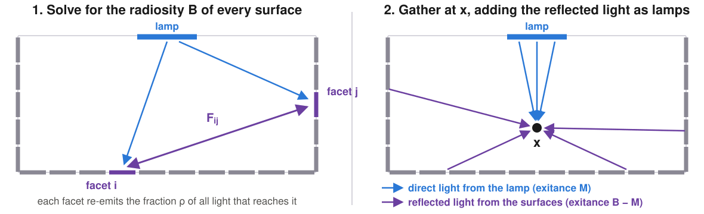{.aqfig .md .nostretch}

::: {.aqeq .small .mid}
::: {.columns}
::: {.column}
| Symbol | Name | SI units |
|--|--------------------|-------|
| $B_i$ | radiosity: all light leaving facet $i$ | W/m² |
| $M_i$ | exitance: emitted part (default 0) | W/m² |
| $B_i - M_i$ | reflected part | W/m² |
| $\rho_i$ | reflectance | - |
| $F_{ij}$ | form factor, with shadows and absorption | - |
:::
::: {.column}
$$B_i = M_i + \rho_i \sum_j F_{ij}\,B_j$$

[Each facet sends out its emission plus the fraction $\rho_i$ of the light arriving from every other facet $j$. This simple form assumes Lambertian emitters and no point or external sources (general form in the full-form slide). One equation per facet gives a linear system for all $B_i$.]{.src}

$$G(\mathbf{x}) = G_{\text{direct}}[M,\dots](\mathbf{x}) + G_{\text{direct}}[B-M,\dots](\mathbf{x})$$

[Then gather at $\mathbf{x}$ as before: the emitters with their own profiles, plus the reflected light $B-M$ of every facet, treated as Lambertian.]{.src}
:::
:::
:::

::: {.notes}
Left panel of the figure: every surface is split into facets. Light from the lamp
lands on the walls, and the walls exchange light with each other, so each facet's
radiosity depends on all the others: that is the linear system. Right panel: once B
is known, the field at any point x is the gather described earlier, with the
emitters' own profiles and exitance M, plus the reflected exitance B − M of every
facet, treated as Lambertian (reflection is purely diffuse). The code forms both in
one pass. The reflected exitance is B − M and not B so the emitted light is not
counted twice. In the exact integral the form factor is reciprocal, A_i F_ij = A_j
F_ji, but the discrete F satisfies this only to the accuracy of the receiver
quadrature (a residual of 0.0078 at six points, independent of mesh refinement); the
row sums are the exact property. The sending facet is integrated exactly with the
projected solid angle and the receiving facet at Q points (six by default). The
stored geometry is multiplied at each solve call by the live body transmittance, the
shadow mask and the medium transmittance, so F as used in the equation includes
shadows and absorption.
:::

## aquaflux model: form factors

::: {.aqrow}
::: {.aqleft .xl style="width:600px"}
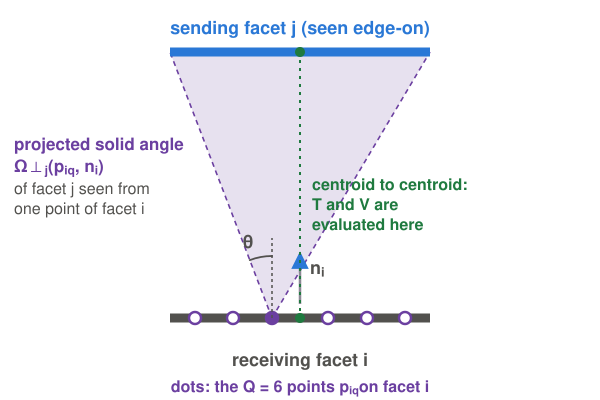{.aqfig .xl .nostretch style="width:600px"}
:::
::: {.aqright .big .aqeq .medium .wrap}
**1. How the geometric part is computed**
$$F^{\text{geo}}_{ij}=\frac{1}{\pi}\sum_{q=1}^{Q} w_q\,\Omega^{\perp}_j(\mathbf{p}_{iq},\mathbf{n}_i),\qquad F^{\text{geo}}_{ii}=0$$

[Facet $j$ is integrated exactly, facet $i$ at $Q$ points with weights $w_q$ that sum to 1. The $1/\pi$ turns radiosity $B_j$ into radiance $B_j/\pi$. Shadows and absorption then scale each entry: $F_{ij}=F^{\text{geo}}_{ij}T_{ij}V_{ij}$.]{.src}

**2. Why the projected solid angle**

[The gather wants the fluence rate, where every direction counts fully (plain $\Omega$). A facet needs irradiance: slanted light spreads over more area, so each direction is weighted by $\cos\theta$, giving $\Omega^{\perp}=\int\cos\theta\,\mathrm{d}\omega.$]{.src}

[**Check.** On the wall of a closed room $\Omega=2\pi$ but $\Omega^{\perp}=\pi$, so $\Omega^{\perp}/\pi$ sums to 1 over all facets, whereas $\Omega/\pi$ would sum to 2. Rows of $F^{\text{geo}}$ sum to 1 in a closed enclosure; reciprocity holds only to the quadrature accuracy.]{.src}
:::
:::

::: {.notes}
F_ij is the fraction of what leaves facet i diffusely that lands on facet j, and
equally the weight with which j's radiosity contributes to the irradiance on i; the
area belongs to the row index, so reciprocity reads A_i F_ij = A_j F_ji. The projected
solid angle of a small facet j seen from p is A_j cos(theta_j) cos(theta_i) / r^2:
one cosine at each end, where the plain solid angle has only the sender's. Using the
plain solid angle here would overstate every transfer by a factor of two over a closed
enclosure, which is the error the row-sum check catches. Because the sending side is
exact, each quadrature point in a closed enclosure sees surroundings whose fractions
sum to one, so every row of the geometric matrix sums to one at any quadrature rule;
in an open set, light leaving through the openings is lost and a row sums to less than
one. Reciprocity holds only to the accuracy of the receiving quadrature (a residual of
0.0078 at the six-point default, a Dunavant rule). The diagonal is zero because a flat
triangle sees none of itself, and point sources take no part in F. The geometry is
computed once; T and V are multiplied in at each call, evaluated along the
centroid-to-centroid segment. Source: aquaflux docs, "Transfer between facets", and
radiation/transfer.py.
:::

## aquaflux model: radiosity system (full form)

::: {.aqeq .small .aqwide .compact}
::: {.columns}
::: {.column}
**1. Irradiance arriving at facet $i$**
$$H_i = \sum_j F^{\text{lamp}}_{ij}\,M_j + \sum_j F_{ij}\,(B_j-M_j) + H_{\text{point},i} + H_{\text{ext},i}$$

[Light from the lamps, using their emission profile; reflected light from the other facets, which is diffuse; point sources; external light.]{.src}
:::
::: {.column}
**2. Radiosity: emitted plus reflected**
$$B_i = M_i + \rho_i\,H_i$$

[Facet $i$ emits $M_i$ and reflects the fraction $\rho_i$ of the irradiance $H_i$ it receives.]{.src}
:::
:::

**3. Put 1 into 2 and collect the unknown $B_j$ on the left**
$$B_i - \rho_i\sum_j F_{ij}\,B_j = M_i + \rho_i\Big[\sum_j \big(F^{\text{lamp}}_{ij}-F_{ij}\big)M_j + H_{\text{point},i} + H_{\text{ext},i}\Big]$$

[One equation per facet, i.e. a linear system $A\,B = s$ with $A = I-\operatorname{diag}(\rho)F$, solved on the next slide. Here $F^{\text{lamp}}_{ij}=F_{ij}\,\pi\,g_j(\cos\theta_{ji})$, which equals $F_{ij}$ for a Lambertian emitter ($\pi g_j=1$). For Lambertian emitters and no point or external sources, this is $B_i = M_i + \rho_i\sum_j F_{ij}B_j$ from the radiosity slide. ($F^{\text{lamp}}$ is written $F^{M}$ in the aquaflux docs.)]{.src}

::: {.columns}
::: {.column}
| Symbol | Name | SI units |
|--|--------------------|-------|
| $H_i$ | irradiance on facet $i$ | W/m² |
| $F_{ij}$ | form factor: diffuse transfer from $i$ to $j$ | - |
| $F^{\text{lamp}}_{ij}$ | same, with the emitter's own profile | - |
:::
::: {.column}
| Symbol | Name | SI units |
|--|--------------------|-------|
| $H_{\text{point},i}$ | irradiance from point sources | W/m² |
| $H_{\text{ext},i}$ | external irradiance (e.g. a measured luminaire) | W/m² |
| $\rho_i$ | reflectance of facet $i$ | - |
| $\theta_{ji}$ | emission angle at $j$ towards $i$ | rad |
:::
:::
:::

::: {.notes}
F^lamp (written F^M in the aquaflux docs) is the weight with which emitting facet j
lights facet i, computed with the emitter's own profile g_j(cos θ) in place of the
diffuse (Lambertian) profile 1/π that defines the ordinary form factor F. F_ij is
the fraction of what leaves i that lands on j, and also the weight with which j's
radiosity contributes to the irradiance at i. For a Lambertian emitter the two are
the same. Reflected light is always treated as diffuse, so it uses F. Only
axisymmetric profiles can enter F^lamp, so a measured (IES) luminaire enters the
solve through the external irradiance that its direct gather gives each facet. Eliminating H gives the system shown, which
is solved matrix-free on the next slide; its right-hand side is the vector s used
there. In matrix form: (I − diag(ρ) F) B = M + diag(ρ) [ (F^lamp − F) M + H_point +
H_ext ]. Point sources lie outside the matrix and enter through H_point.
:::

## aquaflux model: linear solver (GMRES)

::: {.aqeq .small .aqwide .wrap}
::: {.columns}
::: {.column}
**What is solved**
$$A\,B = s, \qquad A = I - \operatorname{diag}(\rho)\,F$$

[$B$ holds one unknown radiosity per facet, $s$ is the right-hand side from the previous slide, and $N$ is the number of facets. $A$ is $N\times N$ because every facet exchanges light with every other, so $F$ is a dense array.]{.src}

[**Who does what.** GMRES (the solver) repeatedly hands aquaflux a trial vector $v$ and gets $A\,v$ back. It needs nothing else about $A$, so $A$ is never formed or factorised: that is what "matrix-free" means here. GMRES stops when $\lVert s - AB\rVert_2 \le 10^{-10}\lVert s\rVert_2$ and restarts every 120 iterations.]{.src}
:::
::: {.column}
**Inside aquaflux's function**
$$(A\,v)_i = v_i - \rho_i \sum_j F_{ij}\,v_j$$

[$v$ is the trial vector GMRES passed in, not the unknown $B$. $i$ is the facet whose entry is computed; $j$ runs over every facet it can receive light from. This is one $N\times N$ matrix–vector product with $F$, assembled at the start of each call.]{.src}

[**Building $F$.** $F_{ij}=F^{\text{geo}}_{ij}\,V_{ij}\,T_{ij}$ (form-factor slide), with $T_{ij}=e^{-a\,d_{ij}}$ for a uniform medium and $d_{ij}$ the centroid separation. The geometry and the mask are computed once; the optical values are applied at each call.]{.src}
:::
:::

**Why this stays affordable**

[**1.** GMRES uses $A$ only through products $A\,v$, so no $N\times N$ matrix is ever factorised.]{.src}

[**2.** The cost is $N^2$ in time and memory, set by the facet count, not the cell count. $F$ and the frozen geometry are kept as several $N\times N$ arrays: 0.45 GB each for the 7,516-facet lamp of the Sozzi reactor, tens of MB for a thousand facets.]{.src}

[**3.** Each row of $F$ sums to at most 1 (exactly 1 for a closed enclosure, before shadows and absorption), so the spectral radius of $\operatorname{diag}(\rho)F$ is at most $\max_j\rho_j$, which bounds the conditioning. CG is not used: it needs a symmetrised system, and most facets have $\rho=0$.]{.src}
:::

::: {.notes}
Plain-language version: the reflections form a chain. Light from the lamp lands on
the walls, some reflects to other walls, and so on; the radiosity of every facet
depends on all the others, hence an N by N system. GMRES is a library solver
(lineax); aquaflux hands it a function that returns A v for any trial vector v.
"Matrix-free" refers to A: the code never builds or factorises I minus diag(rho) F,
it only applies it, as x minus rho times (F x). F itself is a dense N by N array,
assembled at each call as the frozen geometric form factor times the surviving
fraction (the frozen shadow mask with the live body transmittance) times, for a
uniform medium, exp(-a separation). The frozen geometry is three N by N float
arrays (form factor, source cosine, separation) plus the shadow mask (a boolean
array per occluding body and an optional self-shadow array), built once. The
aquaflux docs give 0.45 GB per N by N array for the 7,516-facet lamp, and say a
thousand facets is tens of megabytes and ten thousand is gigabytes; the facet count,
not the cell count, limits the surface system. A non-uniform (voxel) absorption
re-walks every facet pair on every call. The default stop is a global relative
2-norm residual of 1e-10, restart length 120, giving up after 40 stagnant cycles; a
non-converged solve raises. The count the solver returns is restart cycles, not
products, and carries a fixed offset of two from lineax. Convergence: the geometric
rows sum to one in a closed enclosure (an open surface set has rows below one),
which bounds the spectral radius of diag(rho) F by the largest reflectance; the
bounce-by-bounce picture (direct light, then once reflected, and so on) is the
intuition, not the algorithm. The system is not symmetrised for conjugate gradients:
that would need a 1/(rho A) scaling and zero reflectance is the default on every
non-lamp surface. Geometry and the shadow mask are frozen, so they carry no gradient,
and a traced geometry is refused outright (use direct_fluence_rate for position
gradients); reflectance, emission, transmittance and the absorption coefficient stay
live. Checked against aquaflux main at 0193c8b4 (radiation/model.py, transfer.py,
solve/linear.py).
:::

## aquaflux model: occlusion options

::: {.aqrow}
::: {.aqleft .xl}
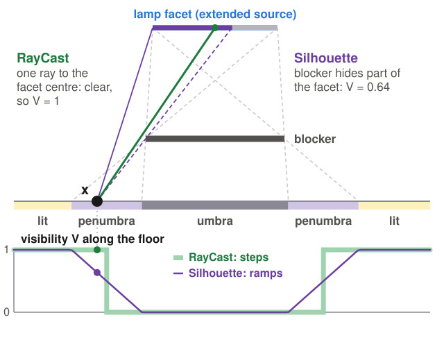{.aqfig .xl .nostretch}
:::
::: {.aqright .big .aqeq .small .wrap}
**Visibility $V_j(\mathbf{x})$**

[The fraction (0 to 1) of lamp facet $j$ that $\mathbf{x}$ can see past other surfaces.]{.src}

| Option | What it does | Use when |
|-------------|---------------------|-------------|
| RayCastOcclusion (default) | One ray from the facet centroid to $\mathbf{x}$: $V=0$ or $1$ | Most cases |
| SilhouetteOcclusion | Clips the facet's directions against the blockers' silhouettes: $V$ is the share of its solid angle left uncovered | Penumbra matters; cost rises steeply with facet count |
| NoOcclusion | Skips shadow tests: $V=1$ | Convex scene, single lamp |

[**Umbra:** where the whole lamp is hidden. **Penumbra:** the soft edge of a shadow, where only part of an extended lamp is hidden. RayCast puts a sharp edge in the middle of the penumbra; Silhouette resolves it. The code never builds these regions; it answers each receiver–facet pair (next slide).]{.src}
:::
:::

::: {.notes}
The picture is a side view of an extended lamp facet above a wider blocker. Under
the blocker there is an umbra, where the whole facet is hidden, with a penumbra on
each side where part of it is hidden. RayCast fires one ray from the facet
centroid, so a pair is recorded wholly blocked or wholly clear and the visibility is
a step that changes where the centroid ray grazes the blocker, in the middle of the
penumbra: the receiver x shown is partly shaded but is treated as fully lit.
Silhouette clips the facet's angular extent against the silhouettes of the blockers
and keeps the uncovered share, so visibility ramps smoothly across the penumbra
(0.64 at x in this sketch, drawn from a simple length ratio; the code's measure is
angular, a projected solid angle for a receiver on a facet and the plain solid angle
for a point in the fluid). Silhouette serves both kinds of receiver, and the receiver
mask follows the same strategy unless receiver_occlusion is set. RayCast is the
default (self_occlusion unset); NoOcclusion is a strategy to pass, not None. Only
analytic bodies and triangle bodies carry a live transmittance; the emitting
surface's own triangles are always opaque. Silhouette errs dark where two separate
blockers each hide part of the same source, because the covered shares are added and
capped at one. Zero-thickness sheets block from both sides only when declared
(two_sided). How the mask is built from these tests is on the next slide. Boundary
conditions: emitting surfaces by exitance (W/m²) or point power (W), reflecting
surfaces by diffuse reflectance, optional external irradiance, and receivers are any
point cloud, typically cell centroids.
:::

## aquaflux model: building the occlusion mask

::: {.aqrow}
::: {.aqleft .xl}
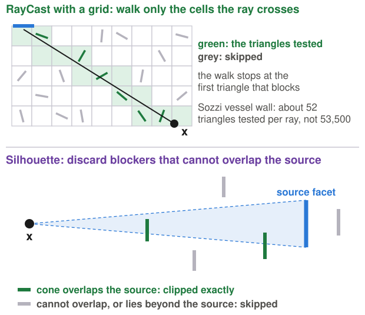{.aqfig .xl .nostretch}
:::
::: {.aqright .big .aqeq .small .wrap}
**1. What the mask is**

[For every receiver and lamp facet, the fraction (0 to 1) of that facet's light that survives the bodies in between. It is built once from the geometry (outside the differentiated path); only each body's transmittance stays live. At mesh scale the receiver mask can be streamed instead of held.]{.src}

**2. Why a speed-up is needed**

[Bodies with a formula (sleeve, baffle, vessel) are cheap to test. A body given as triangles (a vessel wall, or the emitting surface) is the costly case: brute force tests every pair against every triangle. A Sozzi wall of 53,500 triangles would need $6.6\times10^{14}$ tests.]{.src}

**3. Two ways to avoid it**

| | RayCast | Silhouette |
|--------|--------------------|--------------------|
| Steps | Uniform grid: walk only the cells the ray crosses, stop at the first blocker (always for a wall body, optional for the emitting surface) | Per receiver: cone around each triangle and source; skip pairs whose cones cannot overlap; reject pairs that cover nothing; clip the rest exactly |
| Result | About 52 triangle tests per ray, not 53,500 | Only the few surviving pairs are clipped |
:::
:::

::: {.notes}
This answers how the code avoids checking every facet against every other. The
mask has one layer per analytic body and one for the emitting surface's own
triangles. It is computed once, outside the differentiated path, and frozen: it is a
staircase in position, so there is nothing worth differentiating, while the
transmittance of each body stays an ordinary live argument (surviving = product over
bodies of 1 − blocked (1 − transmittance)). The receiver mask is held by default and
is one entry per receiver, facet and body, 12 GB per body at 1.6 million cells
against 7,516 facets, so a mesh-scale model streams it (stream_receiver_mask), which
rebuilds it chunk by chunk at every call. Bodies that can be described analytically
are answered by formula and are far cheaper than any search over triangles; the
emitting surface's own triangles are the fallback for shapes nobody has described.
RayCast tests every ray against every triangle unless the grid option is on (off by
default for the emitting surface's own triangles); a vessel wall given as a triangle
body always uses the grid. With the grid, a 3D-DDA walk (Amanatides and Woo) tests
only the triangles in the voxels the ray crosses. The aquaflux authors measured
about 52 triangle tests per ray against 53,500 for the Sozzi vessel wall, at a 128
cubed grid on 4,000 sampled rays; the default grid has since changed, so treat 52 as
indicative. A ray is abandoned at its first hit. The grid does not reduce the number
of rays, which at mesh scale is the binding cost (1.2e10 segments); a separate shaft
culling step does. Silhouette would cost n cubed if every source-blocker pair were
clipped; its four passes (cones per triangle and source; cone cull by cluster then
pair; reject pairs that certainly cover nothing; clip the rest) remove the pairs that
cannot matter, and the cull's survival falls as the mesh refines. The cull is
conservative: it may keep a pair it did not need but must never drop one that
matters. The terms umbra and penumbra are not used in the code; they describe the
outcome, not the algorithm. Figures from the aquaflux source docs
(radiation/grid.py, self_occlusion.py, model.py) and validation/sozzi_radiation.
:::

## aquaflux model: absorption options

::: {.aqrow}
::: {.aqleft .xl}
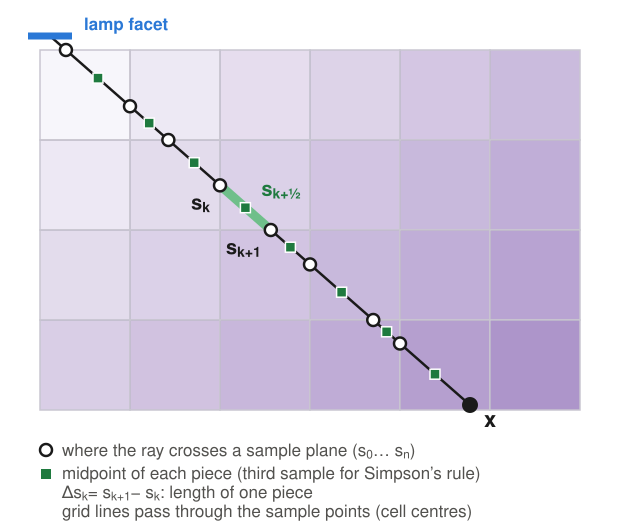{.aqfig .xl2 .nostretch}
:::
::: {.aqright .big .aqeq .small .wrap}
**Transmittance** $T_j(\mathbf{x})$ is Beer–Lambert absorption along the ray from facet $j$ to $\mathbf{x}$.

[**Uniform medium:** $a$ is constant, so $T = e^{-a r}$.]{.src}

[**Voxel grid:** $a$ varies in space and is stored at the cell centres of a regular grid (2D slice shown). Then]{.src}
$$T = \exp\Big(-\int_0^{r} a(s)\,\mathrm{d}s\Big)$$

[The integral is done piece by piece. Split the ray where it crosses planes through the sample points (the cell centres). Between neighbouring sample planes $a$ is trilinear, so along the ray it is a cubic in $s$. Simpson's rule is exact for cubics, so it needs no step size:]{.src}
$$\int_{s_k}^{s_{k+1}} a\,\mathrm{d}s = \frac{\Delta s_k}{6}\Big[a(s_k) + 4\,a(s_{k+\frac12}) + a(s_{k+1})\Big]$$

| Symbol | Name | SI units |
|--|--------------------|-------|
| $a$ | absorption coefficient | m⁻¹ |
| $s$, $r$ | distance along the ray; ray length | m |
| $s_k$, $\Delta s_k$ | sample-plane crossing; piece length | m |
| $T$ | transmittance | - |
:::
:::

::: {.notes}
Beer–Lambert: transmittance is the exponential of minus the absorption integrated
along the path. With a uniform coefficient this is exp(−a r). On a voxel grid the
coefficient is stored at cell centres and interpolated trilinearly. The voxel-grid
path integral splits the ray where it crosses the planes through the cell centres
(the sample planes), not the cell faces; on each piece the trilinear
field is a cubic polynomial along the ray (the figure is a 2D slice, where it
would be quadratic), so Simpson's rule, which samples the two ends and the
midpoint, is exact and needs no step-size parameter. The optical depth is the sum
over pieces. A uniform coefficient is applied in closed form from the frozen centroid
separations; a voxel medium re-walks every pair on every call, with a fixed step
budget, and is differentiable with respect to every cell.
:::

## aquaflux model: validation

::: {.aqeq .small .wrap .aqwide .lim .lim2}
| Test | Expected | Result |
|----------------|--------------|----------------------|
| Uniform enclosure (all walls emit, no absorption, $\rho$ up to 0.9) | $G = 4M/(1-\rho)$ | $\sim10^{-12}$ relative |
| Point source in a black cavity (no absorption) | $G = P/4\pi r^2$ | $\sim10^{-12}$ relative |
| Closed-geometry transfer rows | Sum to 1 | $<10^{-12}$ asserted, $\sim10^{-15}$ measured |
| Reciprocity $A_iF_{ij}=A_jF_{ji}$ | Holds to the receiver quadrature only | Residual 0.0078 at the 6-point default, independent of the mesh |
| Sozzi reactor (uvmesh, 1.2 M cells, black walls, 70% UVT) vs 288-direction DO | Volume-mean $G$ | 0.33% difference |
| Sozzi log reduction vs 288-direction DO | Inactivation rate constants $k=0.01$ to $0.5$ cm²/mJ | Within 0.23% at every $k$ |
:::

::: {.notes}
Rows 1 to 3 are unit tests (tests/unit/test_radiation_model.py and test_radiation_transfer.py): the enclosure and point-source cases assert to a relative tolerance of 1e-12, the transfer rows assert below 1e-12 and measure about 1e-15 for every receiver rule. Reciprocity is a diagnostic, not a gate: the sending facet is integrated exactly and the receiving facet by quadrature, so the residual (against the largest entry of the matrix) is 0.2421, 0.0281, 0.0078 and 0.0045 at 1, 3, 6 and 12 points and does not change under mesh refinement; the row sums, not reciprocity, are exact. The Sozzi comparison is code against code on a water reactor, on the talk's uvmesh mesh (aquaflux sums the mesh's own lamp patches, 87,040 triangles coarsened to 16,878 facets; black walls, 70% UVT); it is not a comparison with measurement, and the quartz-sleeve error in the limitations is not tested here. Whole-reactor means: 133.78 W/m² against 134.22 for DO at 288 directions (0.33%) and 133.29 at 72. DO against aquaflux over cells above 1e-3 of the peak, percentiles 10 to 90: 0.858 to 1.111 at 72 directions and 0.979 to 1.028 at 288, which is DO converging toward the exact gather (both uniform grids, nPhi = nTheta, with linearUpwind rays). The log reduction comes from the Lagrangian tracker (Langevin dispersion) on the same k-ω SST flow and 9,987 particles with only G swapped; DO 72 falls short by 1.0% at k = 0.1 and 2.2% at k = 0.5. On the earlier snappyHexMesh mesh (7,516 lamp facets) the same comparison, against DO on a 16 × 8 grid (256 directions, not uniform), gave 0.09% and within 1.1%. aquaflux's own discretisation error near the lamp is a median 0.44% (p99 4.1%) against the same lamp refined nine times (67,381 facets), on 1500 cells within 5 mm of it (snappy mesh). Sources: validation/sozzi_radiation/uvmesh_swap.py for the uvmesh numbers, validation/sozzi_radiation/README.md for the rest.
:::

## aquaflux model: limitations

::: {.aqeq .small .wrap .aqwide .lim .lim2}
| Limitation | Implication |
|----------------|------------------------------------|
| No refraction or reflection at a quartz sleeve | Neglecting it is a ~6.5% reflection correction at or below 70% transmittance per cm and up to 25% above (Bolton, 2000), so the model suits lower-transmittance water. The DOM library is used for reactors with quartz |
| Walls reflect diffusely only | No specular walls. At equal reflectivity, specular and diffuse walls have been measured 10 to 47% apart in log reduction (Hassanpour et al., 2023) |
| One wavelength, absorbing medium only | One calculation per waveband, and no scattering by the water or air |
| Directional profile evaluated along one direction per facet pair | Energy balance is exact only for diffuse sources; for others it improves as the facets are refined |
| Geometry is frozen | Gradients flow to emission, reflectance, point-source power, profile parameters, body transmittance and absorption, but not to occluder, receiver, mesh-node or (through reflection) lamp positions |
:::

::: {.notes}
Cosine-power sources conserve energy only as the facet mesh is refined: the cause is the single centroid-to-centroid direction at which the profile is evaluated, not the receiver quadrature. The sleeve limitation is the reason the DOM library, not aquaflux, is used for water reactors with quartz. The sleeve figure is Bolton (2000) as quoted in the aquaflux docs: a 6.5% reflection correction below 70% transmittance per centimetre and up to 25% above it, so the model suits lower-transmittance water such as wastewater or the 70% water of the Sozzi and Taghipour (2006) reactor. The specular-versus-diffuse figure is Hassanpour et al. (2023). A waveband needs one calculation per band, weighted afterwards, since the field is linear in emission. Occlusion is frozen (a staircase in position), so shadows carry no gradient, and radiosity and fluence_rate refuse a traced geometry: a lamp-position gradient is available only through direct_fluence_rate and direct_irradiance (black walls). Zero-thickness sheets block from both sides only when declared. Source: aquaflux docs, radiation page.
:::

## Appendix 2: Barycentric dose calculator {.divider}

## Dose calculator: overview

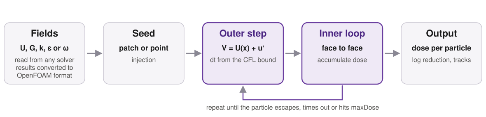{.aqfig .nostretch}

::: {.method .big}
- Runs as the OpenFOAM function object `radiationDose`, under `foamPostProcess`, or inside a solver run
- Reads $\mathbf{U}$ and $G$ from the mesh registry, plus $k$ and $\varepsilon$ (or $\omega$) if dispersion is on; it never calls the radiation solver
- Particles are passive tracers that do not interact with each other or with the flow
- `steady`: frozen $\mathbf{U}$ and $G$, each particle run to completion. `unsteady`: fields re-read every step, one cohort
:::

::: {.notes}
Orientation slide for the whole appendix. The dose calculator is a function object in the radiationDose library. It needs a velocity field and a fluence-rate field and nothing else; k and epsilon (or omega, for a k-omega model such as SST) are needed only if turbulent dispersion is switched on. That is why any radiation solver can feed it: the DOM solver, aquaflux, or the analytical line source. The two highlighted boxes are the loop in the next slides: the outer step samples the flow and adds a turbulent fluctuation, and the inner loop walks the particle from face to face adding dose. In steady mode (the default, used for the Sozzi case) U and G are frozen and every particle runs to completion. In unsteady mode the cohort is seeded once and advanced by the solver's time step, re-reading U and G each call.
:::

## Dose calculator: tracking in tet coordinates

::: {.aqrow}
::: {.aqleft style="width:590px"}
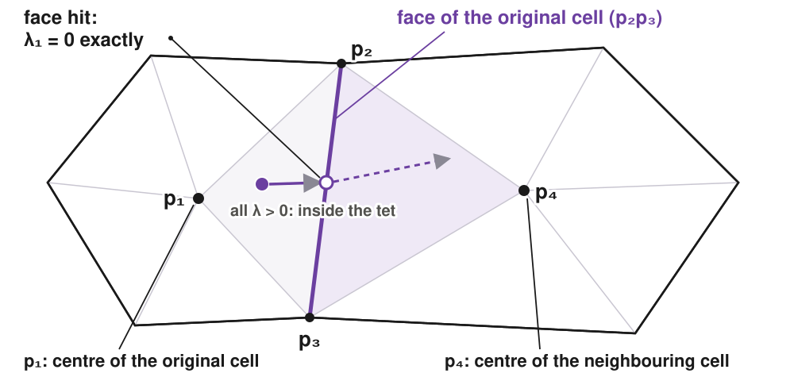{.aqfig .nostretch style="width:590px"}

[2-D analogue: each original cell is cut by joining its centre to each face, so $\mathbf{p}_1$ is the centre of an original cell and $\mathbf{p}_2\mathbf{p}_3$ one of its faces. A triangle has three vertices and three coordinates; a tet has four.]{.src .tight}
:::
::: {.aqright .big .aqeq .small .wrap style="width:650px"}
**Every cell is split into tets**

- Each face of the original cell is cut into triangles, and each triangle is joined to the centre of the original cell: a hexahedron gives 12 tets, whatever the cell shape
- A particle stores its original cell, which of that cell's tets it is in, and four coordinates $\lambda_i$:

$$\mathbf{x}=\sum_{i=1}^{4}\lambda_i\,\mathbf{p}_i,\quad \sum_i\lambda_i=1,\quad \lambda_i\ge 0\ \text{inside}$$

- $\mathbf{p}_1$ is the centre of the original cell; $\mathbf{p}_2$, $\mathbf{p}_3$, $\mathbf{p}_4$ are the corners of one triangle on one of its faces. $\lambda_1=0$ puts the particle on that face of the original cell. Any other $\lambda_i=0$ puts it on a side of the tet inside the original cell, and it moves to the next tet of the same cell
- At seeding, the four $\lambda_i$ are found from the particle's position. As it moves from tet to tet they are updated step by step (next slides)
:::
:::

::: {.notes}
This is OpenFOAM's own particle class; the dose particle derives from it. OpenFOAM does not track in the polyhedral cells directly. Every cell, hexahedron, prism or arbitrary polyhedron, is decomposed on the fly into tetrahedra: each face is split into triangles and each triangle is joined to the cell centre, the centroid of the whole cell (not of a tet). A hexahedron has six faces of two triangles each, so 12 tets. The particle stores the cell, which of the cell's tets it is in (identified by a face and a triangle on that face), and four barycentric coordinates, the weights of the tet's four vertices that give the point. The first weight belongs to the cell centre, the other three to the triangle on the cell face. Inside the tet all four are non-negative. If the first becomes zero the particle is on the cell face; if one of the other three becomes zero it has hit a face between two tets of the same cell, and the tracker switches to the neighbouring tet and carries on. The picture is the 2-D version: the cell centre p1, a cell face p2p3, and the neighbour across the face has its own centre p4. At seeding the coordinates are computed once from the position, through the inverse of the matrix of edge vectors from the cell centre: lambda = (1,0,0,0) + (x - p1) times T over det A, where T over det A is that inverse (OpenFOAM keeps the determinant separate so degenerate or inverted tets still work). From then on they are only updated, never recomputed from x. The next slide shows how. A Cartesian tracker accumulates a small error at each of the thousands of face crossings along a long residence time; here the particle sits on the face with the coordinate set to exactly zero, so that error cannot build up. The source comment says drift is impossible by construction. Particles that cross a processor boundary are handed over by OpenFOAM's Cloud machinery, and the same mechanism carries them across the non-conformal couples used by uvmesh meshes.
:::

## Dose calculator: finding where a track leaves a tet

::: {.aqrow}
::: {.aqleft style="width:560px"}
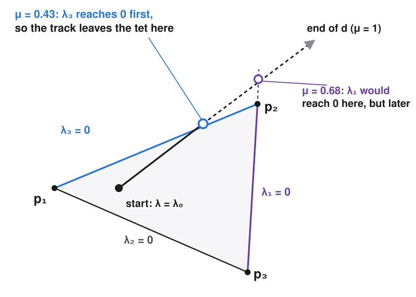{.aqfig .nostretch style="width:560px"}

[2-D analogue: three coordinates and three sides, where a tet has four of each.]{.src .tight}
:::
::: {.aqright .steps}
1. **Follow the coordinates along the path.** The particle travels along $\mathbf{d}{=}\mathbf{V}\,\Delta t$, and $\mu$ is the fraction of it completed: 0 at the start, 1 at the end. Each coordinate changes at a steady rate:

    $$\lambda_i(\mu)=\lambda_{0,i}+\mu\,\delta_i$$

    [$\lambda_{0,i}$ is the value at the start; $\delta_i$ is the change in $\lambda_i$ over all of $\mathbf{d}$.]{.note}

2. **Find the first coordinate to reach zero.** Only a falling coordinate ($\delta_i<0$) can reach zero, and it does so at

    $$\mu_i=-\frac{\lambda_{0,i}}{\delta_i}$$

    [The smallest $\mu_i$, written $\mu_{\min}$, belongs to the side the path crosses first. If every $\mu_i$ exceeds 1, the displacement ends inside the tet, and the next step starts from that point.]{.note}

3. **Move to the exit.** If $\mu_{\min}$ is below 1, the particle moves to the point where that coordinate reaches zero, and the coordinate is set to exactly 0 so the particle sits on that side. That stretch of the path takes the fraction $\mu_{\min}$ of the time left in the step, and the rest of the step continues from there.

**Where the $\delta_i$ come from.** Write $\mathbf{d}$ using the tet's three edges from $\mathbf{p}_1$:

$$\mathbf{d}=\delta_2(\mathbf{p}_2-\mathbf{p}_1)+\delta_3(\mathbf{p}_3-\mathbf{p}_1)+\delta_4(\mathbf{p}_4-\mathbf{p}_1)$$

[Solving for $\delta_2,\delta_3,\delta_4$ is a 3×3 linear system; then $\delta_1=-(\delta_2+\delta_3+\delta_4)$, because the $\lambda_i$ always sum to 1.]{.note}
:::
:::

::: {.notes}
Step one: the position is a linear function of the four coordinates, x = p1 + sum of lambda_i (p_i - p1), so over a straight displacement every coordinate changes at a constant rate. Moving by mu d changes x by mu d, so the rates for coordinates 2 to 4 solve A delta = d, where the columns of A are the three edge vectors from p1; that is, they are the components of d along those edges. Coordinate 1 follows because the four always sum to one. In OpenFOAM the solution is written with triple products (Cramer's rule): the transposed inverse of A scaled by its determinant, stored separately so that degenerate or inverted tets still work. Step two: only a coordinate that is decreasing can reach zero, and it does so at mu_i = minus its starting value over its rate. The smallest of these is the first side of the tet that the straight path meets. If none is below one, the path stops inside the tet. Step three: the particle is placed at that point. The coordinate that reached zero is set to exactly zero, and any round-off negatives are clipped to zero, so the particle sits on the side exactly. The time spent in this tet is mu times the time still left in the step, which is how the segment times in the dose calculation are obtained.
:::

## Dose calculator: crossing into the next tet

::: {.aqrow}
::: {.aqleft style="width:590px"}
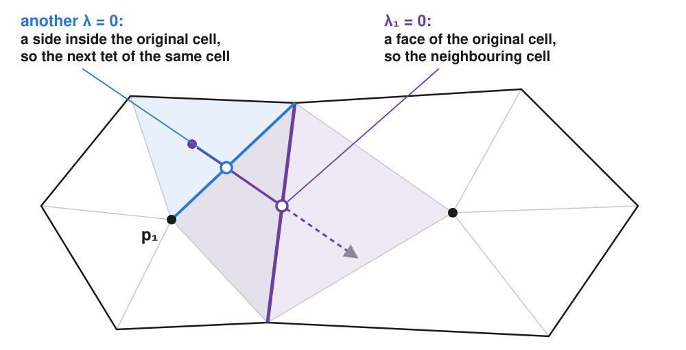{.aqfig .nostretch style="width:590px"}

[Blue: a side inside the cell. Purple: a face of the original cell.]{.src .tight style="text-align:center"}
:::
::: {.aqright .big .aqeq .small .wrap style="width:650px"}
The track has stopped on a side of its tet (previous slide). What happens next depends on which coordinate is zero:

| Zero coordinate | Where the particle is | What happens |
|---|---|---|
| $\lambda_1=0$ | On a face of the original cell | It crosses into the neighbouring original cell, or meets a boundary (wall, outlet or processor patch; see later) |
| $\lambda_2$, $\lambda_3$ or $\lambda_4=0$ | On a side of the tet inside the original cell | It moves to the adjacent tet of the same original cell, and the coordinates are re-expressed for that tet |

- In both cases the rest of $\mathbf{d}$ continues from the exit point, until the step is used up (next slide)
:::
:::

::: {.notes}
The table is what is done with the exit. Coordinate 1 belongs to the cell centre, so zero means the particle is on the cell face and crosses into the neighbour (or hits a boundary, where the wall, outlet or processor rules apply). Any other zero is a side between two tets of the same cell, and the tracker moves to the adjacent tet: the next triangle on the same face, or a triangle of a neighbouring face, with the coordinates reflected or rotated so that they are valid in the new tet. The rest of the displacement continues from there, and the loop repeats until the step is used up. The outer step Δt itself is set on the next slide.
:::

## Dose calculator: dose per face-to-face segment

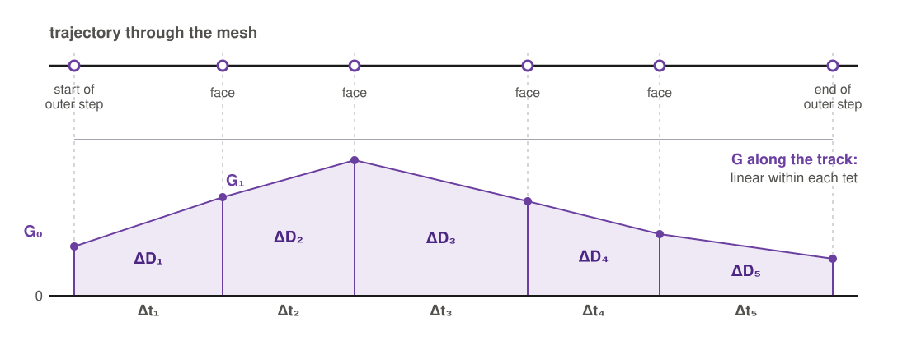{.aqfig .md .nostretch}

::: {.aqeq .small .mid}
::: {.columns}
::: {.column width="50%"}
$$\mathbf{V}=\mathbf{U}(\mathbf{x})+\mathbf{u}',\qquad \Delta t=\min\!\Big(\Delta t_{\max},\ C_{\max}\frac{\sqrt[3]{V_{\text{cell}}}}{|\mathbf{V}_{\text{det}}|},\ \Delta t_{\text{model}},\ t_{\max}-t\Big)$$

[**Outer step.** $\mathbf{U}$ is interpolated once at the start of the step, with $\mathbf{u}'$ from the dispersion model (next slides). $\Delta t_{\max}$ and $C_{\max}$ are the `dtMax` and `cflMax` settings; $V_{\text{cell}}$ is the volume of the current cell. The CFL bound uses the step's deterministic velocity $\mathbf{V}_{\text{det}}$, never its random draw; $\Delta t_{\text{model}}$ is the dispersion model's own limit ($0.02\max(T_L,\,10\ \text{ms})$ for the Langevin model); the last step ends at `maxTime`.]{.src}
:::
::: {.column width="50%"}
$$D=\sum_i 0.1\cdot\tfrac12\,(G_{i-1}+G_i)\,\Delta t_i$$

[**Inner loop.** The particle is tracked face to face until the step is used up, each segment taking the fraction of the step it covers. $G$ is interpolated linearly in each tet and clipped at zero; each segment adds a trapezoid. The factor 0.1 turns W/m²·s into mJ/cm².]{.src}
:::
:::
:::

::: {.notes}
One outer step is at most dtMax long (0.005 s in the Sozzi case) and is shortened so a particle cannot cross much more than half a cell, and to the dispersion model's own limit: for the Langevin model a step is at most 0.02 of the local Lagrangian time scale, and never shorter than 0.2 ms, so steps are shorter near the walls. Inside the step the particle keeps one velocity, the mean flow at the start of the step plus the turbulent fluctuation, and the tracker walks it through as many tets as it crosses. That is the inner loop. The top line in the figure is the track with a dot at each face crossing; the curve below is G sampled at the two ends of each segment. G is linear inside a tet, so the trapezoid is exact for the interpolated field; the dose is the sum of the shaded pieces. The cell size used for the CFL bound is the cube root of the cell volume, a coarse measure. In the code the CFL limit is applied to the displacement velocity, so it also covers the inertial model. Units: G in W/m², D in mJ/cm². 1 W/m² for 1 s is 1 J/m², which is 0.1 mJ/cm².
:::

## Dose calculator: on a wall-resolved mesh, the standard random walk piles particles against the walls

::: {.aqeq .small .mid}
::: {.columns}
::: {.column width="54%"}
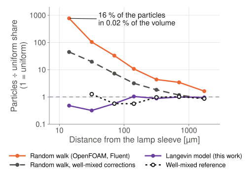{.fig-fill}

[Sozzi reactor, 0.1 < x < 0.7 m: where the particles are 1.5 to 2.5 s after injection, about 20,000 positions per model. One injection has not yet filled the slowest water at the wall, so even the well-mixed reference sits at or below 1 there.]{.src .tight}
:::
::: {.column width="46%"}
$$\sigma=\sqrt{2k/3},\qquad \tau_e=\frac{C_L\,k}{\varepsilon}=\frac{C_L}{C_\mu\,\omega}$$

[Each component of the fluctuation is drawn from $\mathcal{N}(0,\sigma^2)$ and held for the eddy lifetime $\tau_e$, then redrawn (Gosman and Ioannides): the model in OpenFOAM and Fluent.]{.src .tight}

- Next to a resolved wall $k\to 0$, so a particle carried into the first cells barely leaves them
- The well-mixed corrections (a drift $\nabla K$ towards stronger turbulence, with $K=k\tau_e/3$; eddies integrated exactly over each step; eddies reflected at walls) reduce the pile-up but do not remove it
- On the line source the uncorrected walk gives a mean dose of 682 mJ/cm², against 44.3 with the Langevin model
:::
:::
:::

::: {.notes}
The discrete random walk (`discreteRandomWalk`) is the Gosman and Ioannides model that OpenFOAM and Fluent also use. Each velocity component is drawn from a Gaussian with variance 2k/3 and held for the eddy lifetime C_L k/epsilon (or C_L/(Cmu omega) from a k-omega model), capped at 100 s (`tauEMax`); C_L = 0.15 and Cmu = 0.09 by default. Without a correction it violates the well-mixed condition: a uniform distribution of particles does not stay uniform, and particles collect where the turbulence is weak. On the wall-resolved Sozzi mesh that is the viscous sublayer, where k and the mean velocity both go to zero.

The figure: the deck's tracker (of-optical-radiation b23582b) on the slide 10 flow, one injection of 9,987 particles, three snapshots at 1.5, 2 and 2.5 s; particles between the sleeve and the chamber wall for 0.1 < x < 0.7 m, counted in shells by distance from the sleeve and divided by each shell's share of the annulus volume. The uncorrected walk puts 771 times the uniform share in the first 20 µm: 16 % of the particles in 0.02 % of the volume. With the well-mixed corrections (drift grad K, exact eddy accounting, eddy reflection at walls; on by default) it is 45 times, and still 3 times at 100 to 200 µm. The Langevin model stays with the well-mixed reference, the random displacement walk at 0.5 ms steps, which is well mixed by construction; both sit below 1 within 100 µm because one injection has not yet filled the slowest water there. The chamber wall shows the same: uncorrected up to 59 times, corrected 12 times.

Dose on the line source: the uncorrected walk 682 mJ/cm² and a log reduction of 2.00, the corrected walk 67.6 and 1.52, the Langevin model 44.3 and 1.47 (the two random-walk runs predate the seam fix of of-optical-radiation PR #89). On the wall-function snappyHexMesh mesh the corrected walk and the Langevin model agree to 0.02 in log reduction, so the problem is specific to resolving the wall.
:::

## Dose calculator: the Langevin model keeps particles well mixed

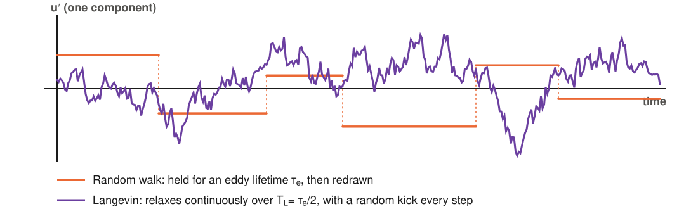{.aqfig .md .nostretch}

::: {.aqeq .small .mid}
::: {.columns}
::: {.column width="50%"}
$$d\mathbf{v}=\Big(-\frac{\mathbf{v}}{T_L}+\nabla\sigma\Big)dt+\sqrt{\frac{2}{T_L}}\;d\mathbf{W},\qquad \mathbf{u}'=\sigma\,\mathbf{v}$$

[Thomson (1987): $\mathbf{v}$ is the fluctuation divided by $\sigma$. It relaxes over $T_L=\tau_e/2$ and gets a random kick $d\mathbf{W}$ every step.]{.src .tight}
:::
::: {.column width="50%"}
- No held eddy: the fluctuation follows the turbulence as the particle moves into weaker or stronger turbulence
- The drift $\nabla\sigma$ keeps a uniform distribution uniform; near the sleeve it matches the well-mixed reference (previous slide)
- Same long-time spreading as the random walk; mean dose within about 1 % of the $\int G\,dV/Q$ ceiling (next slide)
:::
:::
:::

::: {.notes}
The dispersion model used for every Sozzi result in the talk is `langevin`, of-optical-radiation PR #90. The RANS flow gives only the mean velocity, so without a fluctuation every particle would follow a smooth mean-flow path. This model carries a normalized velocity v that relaxes on the Lagrangian time scale T_L, taken as half the random walk's eddy lifetime so that the long-time spreading, K = sigma^2 T_L = k tau_e / 3, is the same, and it gets a fresh random kick every step. The drift term grad sigma is Thomson's well-mixed condition: a uniform distribution of particles stays uniform however the turbulence varies.

Numerics, if asked. Each step is integrated exactly with sigma, grad sigma and T_L frozen at its start, plus the first-order drift their variation along the path adds; for steps much longer than T_L that makes it the diffusion walk with the same K, so one integrator covers the sublayer, where SST's T_L is microseconds, and the bulk. Steps are 0.02 of T_L (`maxStepFraction`), with T_L floored at 10 ms (`minLagrangianTime`) so a step is at least 0.2 ms, and they vary smoothly in space: an earlier version switched abruptly to a diffusion step near the walls, and the jump in step size piled particles up on one side of the switch (Thomson, Physick and Maryon 1997; Postma 2015). The floor is a cost choice: with it the Sozzi mean doses sit 0.6 % (line source) and 1.0 % (DO) above the most a passive tracer can get, and the log reductions agree with the earlier version's to 0.004. k and omega are interpolated linearly in the particle's tetrahedron. The CFL bound sees only the deterministic part of the step, never its random draw, and the velocity is reflected at walls. After a processor hand-off the receiving rank draws a fresh velocity from its stationary distribution. It costs about three times the random walk's run time on this mesh (about 5 minutes on one thread).

Checked by of-optical-radiation's tests against the closed form for an Ornstein-Uhlenbeck velocity, including its short-time spreading; in a closed box where a uniform distribution must stay uniform; and where K varies linearly, against the exact drift grad(K) t, with steps both shorter and much longer than T_L. All three dispersion models (`langevin`, `discreteRandomWalk`, `randomDisplacement`) are selectable.
:::

## Dose calculator: in a steady flow the mean dose cannot exceed ∫G dV / Q

::: {.columns}
::: {.column width="38%"}
::: {.aqeq .small}
$$\bar D\;=\;\frac{1}{Q}\int_V c\,G\,dV\;\le\;\frac{1}{Q}\int_V G\,dV$$

- $c$: particles per unit volume relative to the water's. Water injected continuously fills every region the flow reaches at its own density, so a passive tracer has $c = 1$ there and $c = 0$ in a dead zone
- Holds for any steady flow and residence-time distribution; with $G = 1$ it is the mean residence time $V/Q$ (Spalding 1958)
- The "average dose" of UV design practice (Bircher 2015); RED $\le \bar D$ since $e^{-kD}$ is convex
- Checks the mean only: a tracker can match it with the wrong spread
:::
:::
::: {.column width="62%"}
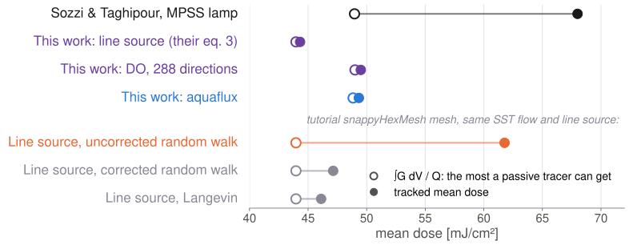{.fig-fill}
:::
:::

::: {.notes}
The identity: particles injected at rate Q accumulate dose at the rate integral of c G dV and leave at rate Q, so the mean dose of those leaving is integral of c G dV over Q, exactly (Little's law). Incompressible water fills the region it reaches at its own density, so a tracer of the water has c = 1 there and the mean dose is the volume integral of G over Q; slow, recirculating water near the lamp is already in the volume integral, and a region the flow never reaches has c = 0, which can only lower the mean. A tracked mean above the integral therefore needs c > 1 in bright water: particles collecting faster than water can, which is what a random walk without the well-mixed drift correction does where the turbulence is weak (MacInnes and Bracco 1992; Thomson 1987). Spalding (1958) proved the residence-time case, V/Q, for steady incompressible flow of arbitrary complexity with variable diffusivity, provided the tracer cannot diffuse back upstream of the injection plane (our tracker reflects particles off the inlet). Bircher (IUVA News 17(2), 2015) gives the average dose of a flow-through reactor from the average irradiance, the volume and the flow rate.

Numbers. Sozzi and Taghipour (2006): their MPSS model (eq. 5) integrated over their Table 1 reactor at their stated 15.8e-4 m3/s gives 49.0 mJ/cm² (the arc centred in the body, which the paper does not state; the lamp holder, which would shade, is not modelled, and both would lower the integral), and their radial model (eq. 3) 44.0 in closed form. Their Lagrangian mean is 68. This work, uvmesh mesh and SST flow, Langevin dispersion: line source 44.3 tracked against 44.0 (44.06 for the field on this mesh); DO at 288 directions 49.5 against 49.0; aquaflux 49.3 against 48.8 (0.6 to 1.0 % above: a sample of 9,987 particles seeded by area rather than flux, and the Langevin model's long steps next to the walls, which over-sample the bright water slightly). The bottom three rows are the same line source on the tutorial's snappyHexMesh mesh and SST flow, where the integral is the closed form: uncorrected random walk 61.8, corrected 47.1, Langevin 46.1 (its first version, of-optical-radiation ebadf6e). The corrected walk and the Langevin model sit 5 to 7 % above the closed form there, probably the line source evaluated at the coarser near-sleeve cell centres of that mesh; not checked.

What it does not show: the log reduction is set by the low-dose tail, which this mean does not constrain. Their 1.87 is an equivalent dose of 43 mJ/cm², under the ceiling. The evidence that over-sampling also lifts the log reduction is our own comparison: the uncorrected walk raises it from 1.45 to 1.56 on the snappy mesh and to 2.00 on the wall-resolved uvmesh mesh, against 1.47 for the Langevin model.
:::

## Dose calculator: motion models

::: {.aqeq .small .wrap}
| Model | Velocity used for the step | Notes |
|---|---|---|
| `tracer` | $\mathbf{V}=\mathbf{U}+\mathbf{u}'$ | Follows the fluid |
| `inertial` | Drag relaxation with time constant $\tau_p$, optional gravity and Brownian kick | Settling and diffusion of particles |
:::

::: {.aqeq .small}
::: {.columns}
::: {.column width="50%"}
**Inertial velocity update**

$$\mathbf{V}_{eq}=\mathbf{U}+\mathbf{u}'+\tau_p\Big(1-\frac{\rho_f}{\rho_p}\Big)\mathbf{g}$$

$$\mathbf{V}^{n+1}=\mathbf{V}_{eq}+(\mathbf{V}^{n}-\mathbf{V}_{eq})\,e^{-\Delta t/\tau_p}+\sigma_V\boldsymbol{\xi}$$

[$\mathbf{V}_{eq}$ is the velocity the particle relaxes towards; $\boldsymbol{\xi}$ is a unit Gaussian vector, drawn once per outer step.]{.src}
:::
::: {.column width="50%"}
**Coefficients**

$$\tau_p=\frac{\rho_p d_p^2}{18\,\mu\,f}$$

$$f=\begin{cases}1 & \text{Stokes}\\ 1+0.15\,Re_p^{0.687} & \text{Schiller–Naumann}\end{cases}$$

$$\sigma_V^2=\frac{k_BT}{m_p}\big(1-e^{-2\Delta t/\tau_p}\big)$$

[$f$ is the drag correction, chosen by the drag model: `stokesDrag` or `schillerNaumann`, with $Re_p$ the particle Reynolds number.]{.src}
:::
:::
:::

::: {.notes}
Most pathogens in a water reactor follow the fluid, so tracer is the default and what the Sozzi case uses. The inertial model is for particles that settle or diffuse. It solves the drag equation exactly over the step (the exponential form), so it stays stable for steps much longer than the particle response time tau_p. Gravity is optional and enters through the buoyancy-corrected term in V_eq. The Brownian kick is the matching stochastic term of an Ornstein–Uhlenbeck process, whose stationary variance is k_B T over particle mass; a log1p-style form keeps it accurate for very small steps. The displacement over the step uses the average velocity, not the end-of-step value. The CFL limit on the dose slide is applied to that displacement velocity. If a wall is hit mid-step, both the end-of-step and the displacement velocities are reflected; for inertial particles this is an approximation of the same order as the step.
:::

## Dose calculator: walls, exits and end of a track

::: {.aqeq .small .wrap}
| Event | What the tracker does | Track state |
|---|---|---|
| Wall patch (`wallReflection true`) | Specular reflection, $\mathbf{V}\to\mathbf{V}-2(\mathbf{V}\!\cdot\!\mathbf{n})\mathbf{n}$; the rest of the step continues in the new direction | active |
| Empty patch (2-D mesh) | Same reflection, so out-of-plane fluctuations bounce back into the mesh | active |
| Escape patch, e.g. `outlet` | Track stops; dose and position are recorded | escaped |
| `maxTime` reached | The last step ends at the limit: position, time and dose are those at `maxTime` | timedOut |
| `maxDose` reached | Dose is capped exactly at the limit | terminated |
| Uncovered face of a non-conformal coupling, or a step back out through the injection patch | Specular reflection | active |
| Wall with reflection off, or any other patch | Track stops | stuck |
| Processor patch | Particle, with its dose, time and velocity, passes to the neighbouring rank | active |
:::

::: {.aqeq .small .mid}
$$\text{LR}_k=-\log_{10}\!\Big[\frac1N\sum_{j=1}^{N}e^{-k D_j}\Big],\qquad j\ \text{over escaped particles only}$$

[Each $k$ in `kInact` (cm²/mJ) gives one log reduction. Particles that timed out, stuck or hit `maxDose` are excluded from the statistics.]{.src}
:::

::: {.notes}
Walls reflect specularly by default, which keeps particles in the reactor (they are not allowed to leave through a wall). Only the escape patches, normally the outlet, end a track as a successful pass. The summary file lists how many tracks ended each way, and the dose statistics and log reductions use only the escaped population, because a particle that timed out is not representative of throughput. maxTime and maxDose are optional (0 disables) and are capped exactly rather than overshooting by one step. A particle that reaches a face of a non-conformal coupling with nothing on the other side (uvmesh joins its pieces this way), or steps back out through the inlet it was seeded on, is reflected (of-optical-radiation PR #89); before that fix such particles ended as stuck, several hundred of 10,000 on the uvmesh mesh. The output files are doseDistribution.csv (track id, end reason, time, dose, end position), a summary file, and VTK trajectories coloured by dose that open in ParaView.
:::

## Dose calculator: seeding and output {.smaller}

| Family | Options |
|---|---|
| Seeding | `patchInjection`: faces chosen in proportion to area, uniform within a face, stochastic rounding so the expected total is `nParticles`. `pointInjection`: sphere or box, rejection-sampled inside the mesh |
| Dispersion | `none`, `discreteRandomWalk` (`wellMixed` on by default), `randomDisplacement`, `langevin` (used here) |
| Motion | `tracer`, `inertial` (`stokesDrag` or `schillerNaumann`) |
| Modes | `steady` (frozen $\mathbf{U}$ and $G$), `unsteady` (fields re-read each call; cohort seeded once; no restart) |
| Output | `doseDistribution.csv`, summary with log reduction, VTK trajectories (`trajectoryStride`, dose filter, `batchSize` to bound memory) |

::: {.notes}
Everything on this slide is a run-time choice in the dictionary; no recompiling. patchInjection weights faces by area and places each particle uniformly inside its face; the number per face is rounded stochastically, so the total is nParticles only in expectation. pointInjection draws points in a small sphere or box and keeps those that fall inside the mesh. In the Sozzi case the seed is fixed (seed 42) so a run repeats.
:::

## Dose calculator: parallel runs and limitations

::: {.columns}
::: {.column width="58%"}
[Parallel runs]{.panel-head .lg}

::: {.method .xl}
- **One rank:** OpenMP threads share out the particles. Each thread has its own random stream, so a run repeats for a given seed and thread count
- **Many ranks:** MPI through OpenFOAM's Cloud. A particle crosses a processor boundary with its dose, time and velocity; the receiving rank draws a fresh fluctuation
- OpenMP and MPI are not combined
:::
:::
::: {.column width="4%"}
:::
::: {.column width="38%"}
[Limitations]{.panel-head .lg}

::: {.method .xl}
- Static meshes only
- Unsteady mode: one cohort of particles, and no restart
:::
:::
:::

::: {.notes}
OpenMP is used only when the run is a single rank, because the processor hand-off machinery inside Cloud::move is not thread-safe. With MPI each rank walks its own particles serially. Only the fluctuation's memory is lost at a hand-off; everything that defines the particle (barycentric position, velocity, dose, time, end state, stored trajectory) is sent. Unsteady mode refuses to restart rather than give a wrong answer.
:::

## Appendix 3: uvmesh {.divider}

## uvmesh: from a Python description to one OpenFOAM mesh

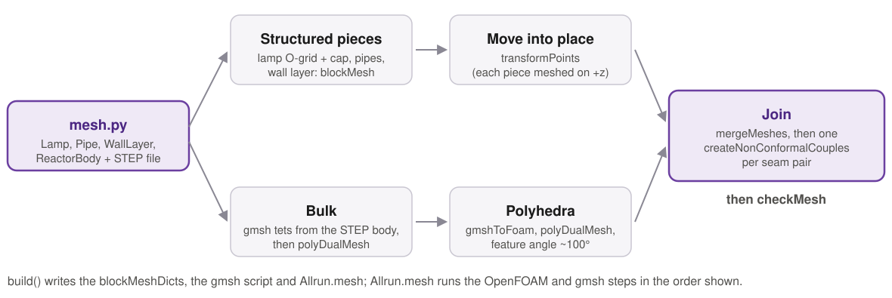{.aqfig .lg .nostretch}

::: {.method}
- A pip-installable Python helper in `tools/uvMesh` of of-optical-radiation: `build()` writes the `blockMeshDict`s, a gmsh script and `Allrun.mesh`
- Needs OpenFOAM 13, gmsh 4.15.2 built with Netgen, and `blockmeshbuilder`; its unit tests need none of them
- Every structured piece is meshed on its own axis and moved into place; the body between them is gmsh tets turned into polyhedra
:::

::: {.notes}
The deck's main slide on uvmesh shows the result; this appendix shows how it is made. mesh.py is the only thing the user writes. build() does not run any meshing itself. It writes one blockMeshDict per structured piece (lamp, each pipe, each wall layer), a gmsh script for the body, and a driver script, Allrun.mesh, that runs everything in order. The structured pieces are meshed with blockMesh on a local axis and then rotated and translated to where they belong, so the dictionaries are the same however the reactor is oriented. The body is meshed by gmsh from the STEP file. Allrun.mesh keeps an existing bulk.msh if it is newer than the gmsh script, so the bulk can be meshed on another machine; that is how the Sozzi mesh in this talk was made, on a host gmsh with Netgen. Finally everything is merged and the pieces are joined with OpenFOAM 13's non-conformal couples.
:::

## uvmesh: a reactor is described by its lamps, pipes, wall layers and STEP body {.smaller}

::: {.dict}
```{.python code-line-numbers="2-7|9-12|13-17|18-21"}
build(case_dir=".",
    lamps=[Lamp(axis_start=(0, 0, 0), axis_end=(0.8, 0, 0),
                sleeve_radius=0.010, annulus_outer_radius=0.022,
                n_radial=26, radial_grading=100.0,
                n_azimuth_per_quadrant=16, n_axial=320,
                endcap_b_shape="hemisphere")],
    body=ReactorBody(step_path="SozziTaghipour.step", step_scale=1e-3,
                     bulk_cell_size=0.004, near_lamp_cell_size=0.0015,
                     bulk_cells="polyhedral", dual_feature_angle=100,
                     optimize_threshold=0.5, optimize_netgen=True),
    pipes=[Pipe(axis_start=(0.889, 0, 0), axis_end=(1.739, 0, 0),
                radius=0.00955, open_patch_name="inlet",
                n_azimuth_per_quadrant=12, n_radial=8, radial_grading=4.0,
                junction_length=0.03, junction_cell_size=0.00125), ...],
    wall_layers=[WallLayer(axis_start=(0, 0, 0), axis_end=(0.889, 0, 0),
                           radius=0.0445, thickness=0.008, n_layers=16,
                           wall_grading=13.6, n_azimuth_per_quadrant=24)])
```
:::

[Trimmed from `data/uvmesh/mesh.py`, the Sozzi & Taghipour reactor (lengths in m). The second pipe, the STEP rotation and the refinement zone along the inlet jet are left out.]{.src}

::: {.notes}
This is the script behind the render in the main deck, trimmed. Four things are described. The lamp: its axis, the sleeve radius, how far the structured layer reaches, and the cell counts; radial_grading is the ratio of the outermost to the innermost cell, so 100 over 26 cells and 12 mm gives a first cell of about 20 micrometres at the sleeve. The body: the STEP file, with a scale from millimetres, and the bulk sizes. The pipes: the axis, the radius, the patch name for the open end, and a graded junction segment so the pipe cells match the bulk where it meets the chamber. The wall layer along the chamber cylinder, 16 cells over 8 mm. All lengths are in metres. A box body can be used in place of a STEP file for simple tests.
:::

## uvmesh: four structured pieces, each a hexahedral block layout

::: {.aqeq .medium .wrap}
| Piece | How it is built | Sozzi reactor settings |
|----|---------|---------|
| Lamp annulus | O-grid: four azimuthal blocks, one graded radial block, one axial block | 26 radial cells, 20 µm at the sleeve growing to about 2 mm (grading 100); 64 around; 320 axial |
| Hemispherical tip | Cubed-sphere shell of five blocks; the azimuth is rotated by π/4 so the cylinder joins it without a hanging node. Same radial grading as the cylinder | tip of the lamp, `endcap_b_shape="hemisphere"` |
| Pipe | Square core plus graded ring; optional wall-layer ring and graded junction segment. The junction end is projected onto the footprint the pipe cuts in the body | 12 cells per quadrant, 8 radial (grading 4), 205 axial; junction 30 mm, down to 1.25 mm |
| Wall layer | Annulus along the chamber cylinder; blocks inside each pipe's window are removed so the pipe attaches there | 16 layers over 8 mm (grading 13.6); 24 per quadrant |
:::

[Each piece has its own seam patch (`lamp0_seam`, `pipe0_seam`, `layer0_seam`) for the non-conformal coupling.]{.src}

::: {.notes}
Why structured pieces at all: near a lamp sleeve you want a layer of hexahedra graded to a first cell small enough for the wall treatment, with cells aligned to the wall; and a pipe wants an O-grid so the cross-section stays regular. A general mesher can do this but it has to be set up by hand for every lamp and pipe. The lamp annulus is a standard O-grid. The hemispherical tip is a cubed sphere (a cube projected onto a sphere) so no cell collapses at the pole; the cylinder's azimuthal nodes are shifted by 45 degrees so the cap and cylinder share nodes. The pipe has a square core with a ring around it; where it meets the chamber, the end is projected onto the surface footprint that gmsh leaves in the body, so the pipe end is a saddle on the cylinder. A separate wall-layer ring can be added to the pipe and to the chamber wall. In the wall layer, the part inside each pipe's window is masked out. The numbers in the right column are the ones used for the Sozzi mesh in the main deck.
:::

## uvmesh: gmsh fills the body, polyDualMesh makes polyhedra, couples join the pieces

::: {.columns}
::: {.column width="50%"}
[Bulk, in gmsh]{.panel-head .lg}

::: {.method .big}
- STEP body with each lamp's cut subtracted; each pipe's solid is left out and its footprint printed on the body surface
- Size fields: distance-and-threshold from each seam, a cylinder field per refinement zone, the minimum of all as the background
- `optimize_threshold` and `optimize_netgen` tighten the tets; the Sozzi mesh uses 0.5 with Netgen
:::
:::
::: {.column width="50%"}
[Dual and join, in OpenFOAM]{.panel-head .lg}

::: {.method .big}
- `polyDualMesh` at `dual_feature_angle` turns tets into polyhedra; 100° keeps right-angle pipe junctions
- `mergeMeshes` puts all pieces in one mesh
- `createNonConformalCouples`, once per pair of bulk seam and piece seam
- `checkMesh` closes the script
:::
:::
:::

[Polyhedra come out about 1.4 times the gmsh size, so the size near each seam is set to give outer layer cells and bulk cells of similar size.]{.src}

::: {.notes}
The bulk is meshed in gmsh from the STEP body. The lamp is cut out as a hole and each pipe is left out as a hole, with its outline printed on the body surface so the pipe can be projected onto it. Mesh sizes come from a background field: small at each seam, growing to the bulk size, so cells next to a structured layer are about the size of its outer cells. Refinement zones add a cylinder of fine cells, for example along the jet from the inlet pipe. The gmsh tets are then converted to polyhedra with polyDualMesh. The feature angle matters: 90 degrees would lose the right-angle junction between pipe and chamber, so the Sozzi mesh uses 100. A low optimisation threshold left three bad dual faces on the Sozzi case, and 0.5 with Netgen removed them. After the dual, the cell zones are removed because polyDualMesh leaves them pointing at the old cells and decomposePar fails on them. Pieces are merged, then each bulk seam is coupled to its piece's seam with a non-conformal couple, so cells do not have to match across the interface. The 1.4 figure is an empirical comment in the example script, not a general rule.
:::

## uvmesh: the lamp cap can be built in several ways, chosen with `bulk_cells`

::: {.aqeq .medium .wrap}
| `bulk_cells` | Cap and bulk | Caveat |
|------|--------|-------|
| `polyhedral` (default; Sozzi) | Cubed-sphere cap on the lamp; capsule-shaped cut in the bulk, dualised to polyhedra | None recorded |
| `tet` | Same, bulk left as tets (no `polyDualMesh`) | Tets only |
| `hybrid` | Tets near the cap, polyhedra elsewhere, stitched | A few bad face pyramids at the stitch; lamps along +z only |
| `structured` | Morphed cubed-sphere cap whose outer envelope is a cylinder plus a flat disc | Only the disc's inscribed square is covered, so the coupling is incomplete |
| `structured_full` | The same cap, projected to cover the whole disc | Full coupling |
| `structured_matryoshka` | Two nested caps; the seam moves to the outer envelope | Outer layer cell count is balanced to the inner automatically |
:::

::: {.notes}
The bulk mesher sees the lamp tip as a curved capsule surface, which polyDualMesh handles less well than flat faces and straight edges. The structured variants avoid that by making the structured piece's outer surface a cylinder plus a flat disc. The cost is how much of the coupling interface is covered: structured leaves four segments of the disc in the bulk, structured_full fixes that, and structured_matryoshka puts a second shell round the first so the seam sits further from the sleeve. The default polyhedral option is what the Sozzi mesh in this talk uses, and it is the simplest. Caveats are as documented in the code: hybrid is restricted to lamps along +z, and keeps a few bad face pyramids at the stitch between tets and polyhedra.
:::

## uvmesh: the Sozzi & Taghipour reactor meshes to 1.2 million cells

::: {.columns}
::: {.column width="52%"}
::: {.method .big}
- STEP file to mesh in about 2 minutes: 1,232,629 cells, maximum non-orthogonality 52.8° (`checkMesh`)
- Same gmsh version, different OpenCASCADE builds: the bulk is 96,833 cells in the container and 96,373 on the host. A rebuild gives a mesh like this one, not the same one
- Limits: box bodies cannot take pipes; STL bodies are not implemented; `hybrid` needs lamps along +z; `checkMesh` reports two or more regions for a coupled mesh, which is expected
- Tests: unit tests (no OpenFOAM needed) check the dictionaries and generated scripts; smoke cases mesh whole reactors and check non-orthogonality, skewness and bad face pyramids
:::
:::
::: {.column width="48%"}
{.fig-fill style="max-height:400px;width:auto"}

[Slice at the lamp tip: structured layer and polyhedral bulk.]{.src .tight}
:::
:::

::: {.notes}
The numbers are from the mesh in the main deck: built 2026-09-30, 1,232,629 cells, maximum non-orthogonality 52.8 degrees from checkMesh in the OpenFOAM 13 image. The bulk was meshed on the host by gmsh from PyPI with Netgen; the repository's Docker image builds the same gmsh version from source, but different OpenCASCADE builds give slightly different tetrahedra, so a rebuild is a mesh of the same kind, not the same mesh. The Sozzi results in the main talk (slides 2, 3, 9, 10 and 15) are on this mesh, with its k-omega SST flow converged at iteration 2059. On the limits: a box body is for simple tests and cannot take pipes yet, STL input raises not-implemented, and hybrid works only for lamps along z. The unit tests need neither OpenFOAM nor Docker. The smoke cases run the real pipeline and assert, for example, non-orthogonality under 90 degrees and skewness under 4.
:::

## Appendix 4: Case settings {.divider}


